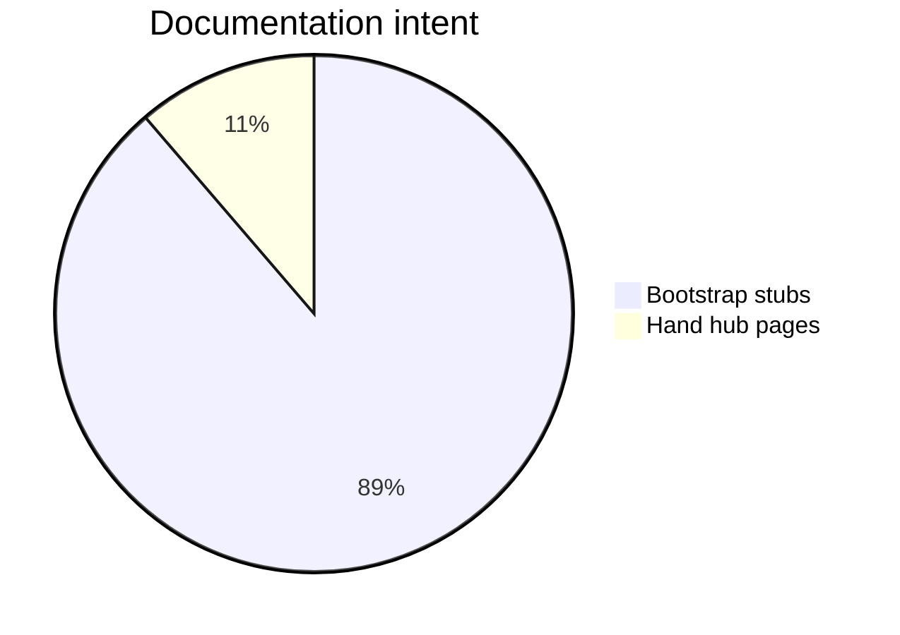

# Documentation coverage

**In plain terms:** the automation checks that many source files have a **markdown neighbor**. That is not the same as “every page is a complete guide.”

## Two layers

| Layer | Meaning |
| ----- | ------- |
| **Co-located neighbors** | `scripts/bootstrap-co-located-docs.mjs` ensures `*.md` beside many `src/**` files |
| **Curated hub** | Guides, philosophy, products, and idling sections in the sidebar |



Exact stub counts change when bootstrap runs; see the live HTML report at [/coverage/](https://docs.idling.app/coverage/) (synced from `doc-coverage-report.json`).

## Commands

```bash
pnpm docs:coverage:bootstrap   # ensure neighbors exist
pnpm docs:coverage:refresh     # analyze + bootstrap + badge sync
pnpm docs:doctor               # automation health
```

## Honest badge language

The homepage badge describes **adequate documentation** for in-scope files (`adequately_documented / total_code_files`), not editorial completeness of every hub page. Adequate human docs are tracked in the [product inventory](/products/inventory) with `last_verified` dates.

## When to edit what

- Fixing Jest/Yarn myths → [Guides](/guides/stack) and [Testing](/guides/testing)
- API accuracy → [Idling API overview](/idling/api-overview), co-located `src/app/api/**/*.md`, and Redoc at `/api/`
- New product → showcase TypeScript **and** `src/products/showcase/<id>.md`

---

**Sources:** `scripts/bootstrap-co-located-docs.mjs`, `package.json` (`docs:coverage:*`, `docs:doctor`), `src/documentation-coverage.mdx`