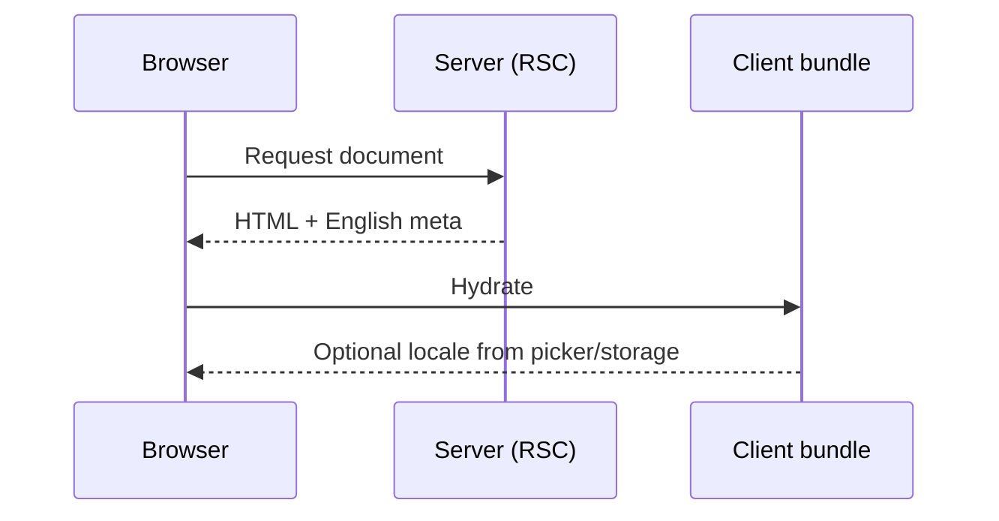

# SSR metadata and locales

**In plain terms:** pages that Google and Discord read on first load use **English metadata from the server**. Translated UI copy loads later in the browser when the user picks a locale.

## The gotcha

Next.js App Router **server components** cannot safely depend on async per-request locale chunks for `<title>` and Open Graph tags without slowing every navigation. idling.app therefore keeps:

- **Static / sync English** strings in `getServerLL()` (`src/i18n/idling-server-i18n.ts`)
- **Client-only** locale switching via `IdlingLocaleProvider` (`src/app/components/locale/IdlingLocaleProvider.tsx`) and `localStorage` key `idling-ui-locale`

`getServerLL` implementation (audited):

```typescript
export const getServerLL = cache((): TranslationFunctions => {
  initIdlingI18n('en');
  return getLL();
});
```

The file is `import 'server-only'` — do not import it from client components.



## What stays English on the server

| Concern | Pattern |
| ------- | ------- |
| `generateMetadata` titles/descriptions | `getServerLL()` or hard-coded EN marketing copy |
| Open Graph tags | Same — no async locale import |
| Quote ticker / message shards | **Client-only** — see [Quotes](/idling/quotes) |
| Radio / tools marketing meta | EN `generateMetadata` on each segment unless segment-specific ADR |

## Policy

1. Do not add `cookies()`-driven locale to root `layout.tsx` metadata without an ADR and performance budget.
2. Product marketing routes may use English `generateMetadata` with stable OG images (`/api/og-image` or static assets).
3. Footer locale picker is the supported way to change UI language — not `Accept-Language` alone.
4. Locale cookie `writeIdlingLocaleCookie` is for client/server handoff of picker choice, not for bulk RSC string loading.

## Deep dive file

Implementation notes also live in `src/i18n/i18n-ssr-metadata-gotcha.mdx` (co-located). This hub page is the human entry point.

## Related

- [Internationalization](/guides/i18n)
- [Idling application](/idling/index)
- [Stack](/guides/stack)

---

**Sources:** `src/i18n/idling-server-i18n.ts`, `src/app/components/locale/IdlingLocaleProvider.tsx`, `src/molecules/quotes/resolveIdlingLocale.ts`, `src/molecules/quotes/writeIdlingLocaleCookie.ts`