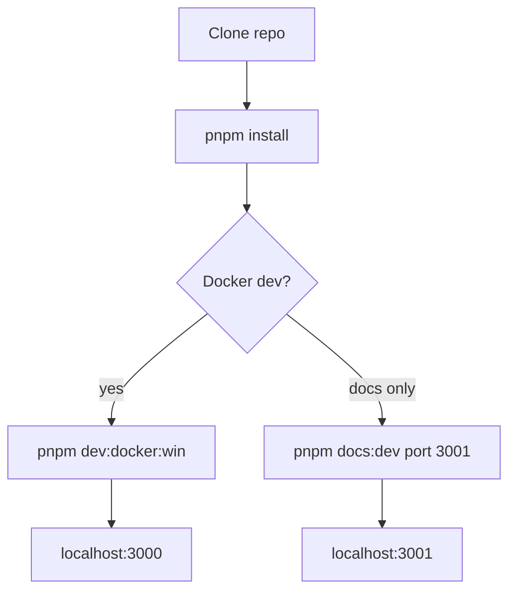

# Guides

**What this page is about:** practical onboarding for idling.app__UI — written for new contributors and for operators who need commands that match `package.json` today.

## Start here

1. [Getting started](/guides/getting-started) — pnpm, Docker, ports 3000 / 3001  
2. [Stack & tooling](/guides/stack) — Node 22+, Next 16, no Jest  
3. [Testing](/guides/testing) — Vitest + Playwright  
4. [Internationalization](/guides/i18n) — catalog refresh and locale policy  
5. [SSR metadata gotcha](/guides/i18n-ssr-metadata) — why RSC stays English  
6. [Contributing](/guides/contributing) — PR habits and doc rules  
7. [Documentation coverage](/guides/documentation-coverage) — stubs vs hub pages  
8. [Source-audit rule](/guides/source-audit) — cite implementation paths in **Sources** footers  
9. [Idling application](/idling/) — features shipped in this Next.js repo (radio, PWA, tools)

---

**Sources:** `package.json`, `docusaurus.config.js` (`routeBasePath: '/'`, docs port 3001), hub pages under `src/guides/`