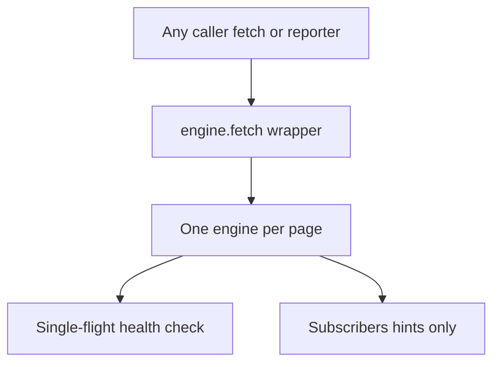

# Architecture

**In plain terms:** OCE is a small **pure** network-hint engine with clear plug-in points (observed `fetch`, subscribe, reporter). It imports nothing from `APIClient`, React, or Axios.

| Everyday idea | Engine idea |
| ------------- | ----------- |
| Server sent a response | `reportResponse` / settlement `response` |
| Request never got an answer | `reportTransportFailure` / settlement `transport-failure` (code name) |
| User cancelled | `reportIgnored` / `ignored` |

## CLAD seams

| Layer | Responsibility |
| ----- | -------------- |
| **Port (interface)** | `ConnectivityEngine` — `getSnapshot`, `subscribe`, `fetch(base)`, `reporter` |
| **Implementation** | `new ConnectivityEngine(config)` — generation, streak, probe orchestration |
| **Adapter** | Host `ConnectivityEngine` / explicit `ConnectivityEngine` reference (context or module) |
| **Recipe** | `OCE.fetch`, `<OceProvider>`, data-library fetchers |

```text
new ConnectivityEngine(config) → engine
engine.getSnapshot()
engine.subscribe(listener) → unsubscribe
engine.fetch(baseFetch) → wrappedFetch
engine.reporter.reportResponse()
engine.reporter.reportTransportFailure()
engine.reporter.reportIgnored()
```



## Host ownership (not a global engine)

Agnostic OCE has **no** `globalThis` registry. The host constructs one `ConnectivityEngine` and passes that instance to microfrontends through **module scope** (`OCE` on idling.app) or an explicit export (`appFetch`).

- **First construction** owns config (`healthCheckUrl`, thresholds, attachment).
- **Remotes** subscribe to the **same object reference** the host created — they do not call `new ConnectivityEngine` again.
- **Never** replace `globalThis.fetch`; inject `client.fetch` into HTTP libraries.

### Scope limits (v1)

| Scope | Sharing |
| ----- | ------- |
| Same-origin microfrontends on one page | One engine reference from host bootstrap |
| Cross-origin iframe | Separate engine — cannot see parent flag |
| Another browser tab | Separate engine — no `BroadcastChannel` / `SharedWorker` in v1 |

## Snapshot fields

`unavailable` is **not** set on the first failure alone. After `streak` reaches `failureThreshold`, **`confirm()`** runs a single health GET; only a **failed** probe (or rejected health contract) sets `unavailable: true`. Any ordinary **`Response`** recovers without calling health.

Scenario diagrams: [Network flow](/guides/offline-connectivity-engine/network-flow).

```ts
export type ConnectivitySnapshot = {
  /** Confirmed after streak + failed health confirm — not the first blip */
  unavailable: boolean;
  /** Consecutive connection failures (no Response) at current generation */
  streak: number;
  failureThreshold: number;
  /** Bumped on each successful Response; stale probes compare against this */
  generation: number;
  /** True when interpretHealthResponse rejected the probe Response */
  healthContractFailed?: boolean;
};
```

## Generation and stale results

Concurrent failures from many microfrontends must not let a **slow** wave undo a **newer** recovery.

```ts
// Pseudocode — settlement handler
function onSettled(token: { generation: number }, kind: SettlementKind): void {
  if (token.generation !== generation) {
    return; // stale wave — discard
  }
  if (kind === 'ignored') {
    return; // AbortError — no streak change
  }
  if (kind === 'response') {
    generation += 1;
    streak = 0;
    unavailable = false;
    publish();
    return;
  }
  // connection failure — no Response
  streak += 1;
  if (streak < failureThreshold || unavailable) {
    publish();
    return;
  }
  void confirm();
}
```

Success while a probe is in flight bumps generation; the probe result is **discarded** when it settles (FR-OCE-004).

## Single-flight probe

At `failureThreshold`, `confirm()`:

1. **Reuses** `inflightProbe` if one already exists.
2. **Reuses** an observed in-flight call to `healthCheckUrl` instead of duplicating the request.
3. Otherwise starts an engine-owned `GET` with `cache: 'no-store'`, `credentials: 'omit'`, and `AbortSignal.timeout(presetMs)` (probe controller is **not** the user's `AbortController`).

```ts
async function confirm(): Promise<void> {
  if (inflightProbe) {
    return inflightProbe;
  }
  const capturedGeneration = generation;

  inflightProbe = (async () => {
  try {
    const result = await runHealthCheck(); // shared or engine-owned
    if (generation !== capturedGeneration) {
      return; // recovery already happened
    }
    if (isResponse(result) && interpretHealthResponse(result)) {
      generation += 1;
      streak = 0;
      unavailable = false;
    } else {
      unavailable = true;
    }
    publish();
  } finally {
    inflightProbe = null;
  }
  })();

  return inflightProbe;
}
```

Parallel failures: ten `TypeError`s at the same generation increment streak under a mutex; only the transition to threshold calls `confirm`, and `confirm` single-flights (FR-OCE-003, FR-OCE-008).

## Classification

```ts
// `transport-failure` = connection failed before any Response (stable type name in code)
export type SettlementKind = 'response' | 'transport-failure' | 'ignored';

export function classify(value: unknown): SettlementKind {
  if (value instanceof Response) {
    return 'response'; // status ignored; opaque included
  }
  if (value instanceof Error && value.name === 'AbortError') {
    return 'ignored';
  }
  if (value instanceof Error && value.name === 'TimeoutError') {
    return 'transport-failure';
  }
  return 'transport-failure'; // TypeError, DNS, CORS, CSP, mixed content
}
```

## Non-blocking `engine.fetch`

```ts
export function engine.fetch(
  engine: ConnectivityEngine,
  baseFetch: typeof fetch,
): typeof fetch {
  return async function wrappedFetch(
    input: RequestInfo | URL,
    init?: RequestInit,
  ): Promise<Response> {
    const token = engine.onStart(input);
    try {
      const response = await baseFetch(input, init); // always
      engine.onSettled(token, classify(response));
      return response;
    } catch (error) {
      engine.onSettled(token, classify(error));
      throw error;
    }
  };
}
```

When `unavailable` is already true, `engine.fetch` **still** calls `baseFetch` and returns or rethrows unchanged (FR-OCE-006).

---

**Sources (specified):** OCE plan — concurrency section, `host bootstrap (hold your ConnectivityEngine / ConnectivityEngine)`, generation, single-flight probe, FR-OCE-001..008.