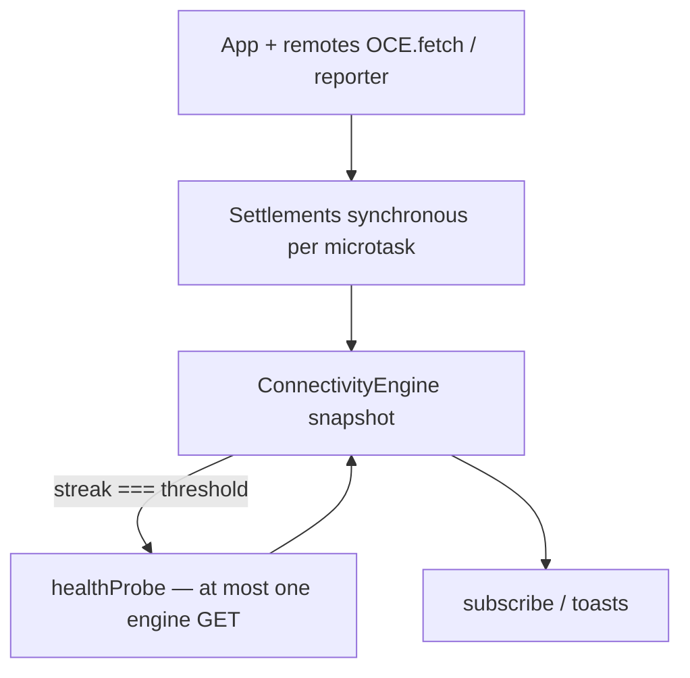

# Architecture

**In plain terms:** OCE is a **traffic-driven** hint engine. Settlements come from real `fetch` outcomes (or `reporter`); health confirm is **one network GET at a time**, coordinated with `AbortController` and a shared in-flight promise.

| Everyday idea | Engine idea |
| ------------- | ----------- |
| Server sent a response | `response` settlement |
| Request never got an answer | `transport-failure` settlement |
| User cancelled | `ignored` settlement |

## CLAD seams

| Layer | Responsibility |
| ----- | -------------- |
| **Port (interface)** | `ConnectivityEngine` — `getSnapshot`, `subscribe`, `fetch(base)`, `reporter` |
| **Implementation** | `new ConnectivityEngine(config)` — generation, streak, `healthProbe()` |
| **Adapter** | idling.app `OCE` module + `<OceProvider>` |
| **Recipe** | `OCE.fetch`, data-library fetchers wired to same `fetch` |



## Host ownership

- **One** `ConnectivityEngine` per page (`OCE.ts` on idling.app).
- Remotes use the **same** `OCE.fetch` reference (`IdlingOceEmbedRegistry` for radio).
- **Never** patch `globalThis.fetch`.

## Snapshot fields

See [Network flow](/guides/offline-connectivity-engine/network-flow) for the full table. Highlights:

- **`unavailable`** — after threshold failures **and** failed health confirm (or strict health contract).
- **`generation`** — bumps on each recovery; stale settlements and late probe results are ignored.
- **`lastHealthyAt`** — last confirmed healthy observation (UTC ms).

## Settlement loop (pseudocode)

```ts
function onSettled(token, kind) {
  if (token.generation !== generation) return;
  if (kind === 'ignored') return;
  if (kind === 'response') {
    if (unavailable) scheduleDebouncedRecovery(token.generation);
    else markHealthy(token.generation);
    return;
  }
  streak += 1;
  publish();
  if (unavailable || streak < failureThreshold || streak > failureThreshold) return;
  void healthProbe({ fresh: true }).then((r) => applyHealthResult(token.generation, r, 'confirm'));
}
```

Confirm runs only when **`streak === failureThreshold`** (not on every failure after that).

## Network-first `healthProbe()`

One outcome path for navigator verify, streak confirm, and cached reads:

1. **Cache** — reuse last result within `healthProbeReuseMs` (4s idling default), unless `{ fresh: true }` (confirm).
2. **Observed traffic** — join an in-flight app `GET` to `healthCheckUrl` (e.g. `/api/version` via `OCE.fetch`).
3. **Engine GET** — single shared promise; `AbortController` merged with `AbortSignal.timeout(probeDeadline)`.

Concurrent callers `await` the **same** promise. Teardown (`resetForTests`, `detachNavigatorOnLine`) **aborts** the engine controller; stale completions use `engineHealthEpoch` and return `ignored`.

Navigator `online` / `offline` handlers are **debounced** (`navigatorVerifyDebounceMs`, 600ms idling) before calling `healthProbe()`.

## Classification

| Outcome | `SettlementKind` | Streak |
| ------- | ---------------- | ------ |
| `Response` (any status) | `response` | Cleared on recovery path |
| `AbortError` | `ignored` | Unchanged |
| `TimeoutError`, `TypeError`, … | `transport-failure` | `++` |

## Non-blocking `engine.fetch`

When `unavailable` is already true, wrapped `fetch` **still** calls `baseFetch` (FR-OCE-006).

---

**Tests:** `src/lib/oce/connectivity/connectivity.engine.test.ts` (FR-OCE-001 … FR-OCE-014).