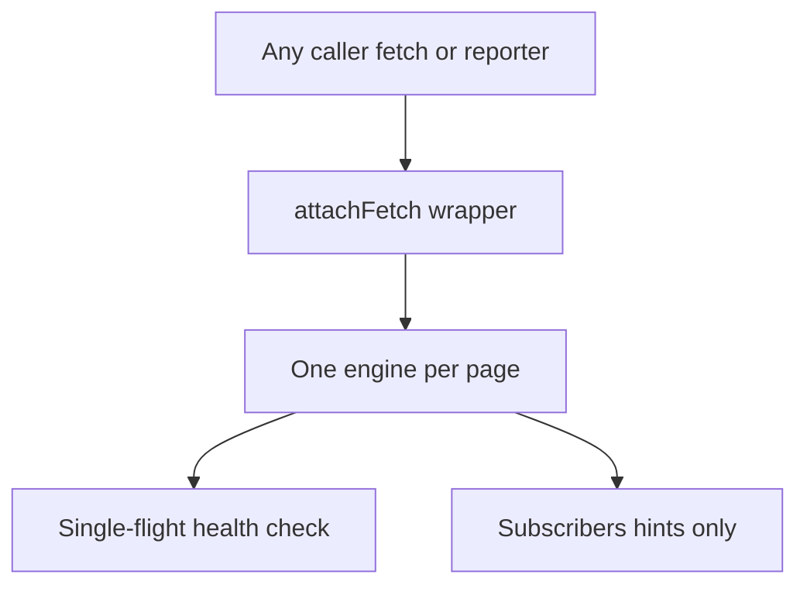

# Architecture

**In plain terms:** OCE is a small **pure** connectivity engine with explicit seams (attach fetch, subscribe, reporter). It imports nothing from `APIClient`, React, or Axios.

## CLAD seams

| Layer | Responsibility |
| ----- | -------------- |
| **Port (interface)** | `ConnectivityEngine` — `getSnapshot`, `subscribe`, `attachFetch`, `reporter` |
| **Implementation** | `createConnectivityEngine(config)` — generation, streak, probe orchestration |
| **Adapter** | `getPageConnectivityEngine()` — page singleton on `globalThis` |
| **Recipe** | Host bootstrap, React hook, framework interceptors |

```text
createConnectivityEngine(config) → engine
engine.getSnapshot()
engine.subscribe(listener) → unsubscribe
engine.attachFetch(baseFetch) → wrappedFetch
engine.reporter.reportResponse()
engine.reporter.reportTransportFailure()
engine.reporter.reportIgnored()
```



## Global singleton

`getPageConnectivityEngine` stores the engine on `globalThis[Symbol.for("@strixun/oce")]`.

- **First caller** creates the engine with the provided config.
- **Later callers** receive the **same** object and do **not** reset streak or flag.
- If a later call passes a different `healthCheckUrl`, config does **not** override — log a warning.

```ts
declare const OCE_GLOBAL_KEY: unique symbol;

const OCE_SYMBOL = Symbol.for('@strixun/oce') as typeof OCE_GLOBAL_KEY;

export type PageConnectivityEngine = ReturnType<typeof createConnectivityEngine>;

export function getPageConnectivityEngine(
  config?: ConnectivityEngineConfig,
): PageConnectivityEngine {
  const g = globalThis as typeof globalThis & {
    [OCE_SYMBOL]?: PageConnectivityEngine;
  };
  if (g[OCE_SYMBOL]) {
    if (config?.healthCheckUrl && config.healthCheckUrl !== /* stored */) {
      console.warn('[OCE] healthCheckUrl ignored — engine already created');
    }
    return g[OCE_SYMBOL];
  }
  const engine = createConnectivityEngine(config ?? defaultConfig);
  g[OCE_SYMBOL] = engine;
  return engine;
}
```

### Scope limits (v1)

| Scope | Sharing |
| ----- | ------- |
| Same-origin microfrontends on one page | One engine via symbol |
| Cross-origin iframe | Separate engine — cannot see parent flag |
| Another browser tab | Separate engine — no `BroadcastChannel` / `SharedWorker` in v1 |

## Snapshot fields

```ts
export type ConnectivitySnapshot = {
  /** Best-effort hint — not a guarantee */
  unavailable: boolean;
  /** Consecutive transport failures at current generation */
  streak: number;
  failureThreshold: number;
  /** Bumped on each successful Response; stale probes compare against this */
  generation: number;
  /** True when interpretHealthResponse rejected the probe Response */
  healthContractFailed?: boolean;
};
```

## Generation and stale results

Concurrent failures from many microfrontends must not let a **slow** wave undo a **newer** recovery.

```ts
// Pseudocode — settlement handler
function onSettled(token: { generation: number }, kind: SettlementKind): void {
  if (token.generation !== generation) {
    return; // stale wave — discard
  }
  if (kind === 'ignored') {
    return; // AbortError — no streak change
  }
  if (kind === 'response') {
    generation += 1;
    streak = 0;
    unavailable = false;
    publish();
    return;
  }
  // transport failure
  streak += 1;
  if (streak < failureThreshold || unavailable) {
    publish();
    return;
  }
  void confirm();
}
```

Success while a probe is in flight bumps generation; the probe result is **discarded** when it settles (FR-OCE-004).

## Single-flight probe

At `failureThreshold`, `confirm()`:

1. **Reuses** `inflightProbe` if one already exists.
2. **Reuses** an observed in-flight call to `healthCheckUrl` instead of duplicating the request.
3. Otherwise starts an engine-owned `GET` with `cache: 'no-store'`, `credentials: 'omit'`, and `AbortSignal.timeout(presetMs)` (probe controller is **not** the user's `AbortController`).

```ts
async function confirm(): Promise<void> {
  if (inflightProbe) {
    return inflightProbe;
  }
  const capturedGeneration = generation;

  inflightProbe = (async () => {
  try {
    const result = await runHealthCheck(); // shared or engine-owned
    if (generation !== capturedGeneration) {
      return; // recovery already happened
    }
    if (isResponse(result) && interpretHealthResponse(result)) {
      generation += 1;
      streak = 0;
      unavailable = false;
    } else {
      unavailable = true;
    }
    publish();
  } finally {
    inflightProbe = null;
  }
  })();

  return inflightProbe;
}
```

Parallel failures: ten `TypeError`s at the same generation increment streak under a mutex; only the transition to threshold calls `confirm`, and `confirm` single-flights (FR-OCE-003, FR-OCE-008).

## Classification

```ts
export type SettlementKind = 'response' | 'transport-failure' | 'ignored';

export function classify(value: unknown): SettlementKind {
  if (value instanceof Response) {
    return 'response'; // status ignored; opaque included
  }
  if (value instanceof Error && value.name === 'AbortError') {
    return 'ignored';
  }
  if (value instanceof Error && value.name === 'TimeoutError') {
    return 'transport-failure';
  }
  return 'transport-failure'; // TypeError, DNS, CORS, CSP, mixed content
}
```

## Non-blocking `attachFetch`

```ts
export function attachFetch(
  engine: PageConnectivityEngine,
  baseFetch: typeof fetch,
): typeof fetch {
  return async function wrappedFetch(
    input: RequestInfo | URL,
    init?: RequestInit,
  ): Promise<Response> {
    const token = engine.onStart(input);
    try {
      const response = await baseFetch(input, init); // always
      engine.onSettled(token, classify(response));
      return response;
    } catch (error) {
      engine.onSettled(token, classify(error));
      throw error;
    }
  };
}
```

When `unavailable` is already true, `attachFetch` **still** calls `baseFetch` and returns or rethrows unchanged (FR-OCE-006).

---

**Sources (specified):** OCE plan — concurrency section, `getPageConnectivityEngine`, generation, single-flight probe, FR-OCE-001..008.