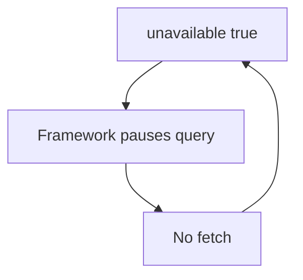

# Framework deadlocks

**In plain terms:** OCE only learns what the transport **actually did**. Frameworks that **pause**, **continue**, or **ignore** can skip the HTTP call or resolve a fallback — then the flag never clears. **FR-OCE-010** requires consumers to record outcomes and **not** wire the OCE flag into “am I allowed to fetch?”

## The core deadlock

Recovery requires a real `Response` on ordinary traffic. If you skip HTTP when `unavailable` is true, you remove the only up-path.

```ts
// Forbidden — any library
if (oce.getSnapshot().unavailable) {
  skipHttp();
} else {
  fetch();
}
```

The call must run in **both** branches — meaning you should not branch at all:

```ts
// Correct
await fetchWithOce(url, init);
```



## Pattern catalog

| Framework signal | Risk | Fix |
| ---------------- | ---- | --- |
| TanStack `networkMode: 'online'` | `queryFn` never runs → `paused` | `networkMode: 'always'` on user queries/mutations |
| TanStack `onlineManager` ← OCE flag | Pauses entire client | Do not connect; leave assuming online |
| TanStack `offlineFirst` | Cache looks like first `Response` | Use `always` for OCE-informed queries |
| Axios `.catch(() => data)` | Resolved fallback, no reject | `Promise.reject` after `reporter` |
| Apollo `errorPolicy: 'ignore'` without link | Skip HttpLink | Always perform HTTP; ignore only in UI layer |
| SWR fetcher catch → `undefined` | Hides error state | Rethrow or report before fallback |
| `if (unavailable) return cached` | Skips network | Always fetch; cache as hint only |

## FR-OCE-010 narrative

**Requirement:** A consumer that would pause, ignore, or continue **without** an HTTP call still records the outcome. TanStack `networkMode: 'online'` / `paused` must **not** be wired to the OCE flag. A resolved fallback (`errorPolicy: 'ignore'`, axios catch that returns data, a `queryFn` that swallows) does **not** erase a transport failure that already happened, and it must **not** skip the next user-initiated call.

### Test mindset (specified, not yet implemented)

```ts
test('[FR-OCE-010] user-initiated query runs when unavailable is true', () => {
  const baseFetch = vi.fn().mockRejectedValue(new TypeError('Failed to fetch'));
  const engine = createConnectivityEngine({
    healthCheckUrl: '/health',
    failureThreshold: 1,
  });
  const fetchWithOce = engine.attachFetch(baseFetch);
  // drive engine to unavailable via failures + failed probe ...
  // assert fetchWithOce still invoked when user triggers action
});
```

### Integration checklist

1. User-triggered work uses the mode that **still performs the call** (`always`, reject after report, `none` + link that already fetched).
2. Report at the **transport**, before the framework **continue**.
3. Never feed `unavailable` into the framework’s online bit.
4. UI may show hints; buttons stay enabled (except local validation like empty form).

## TanStack `paused` vs OCE

When `fetchStatus === 'paused'`, no bytes hit the wire. If pause correlates with `unavailable`, the system latches. See [TanStack Query recipe](/guides/offline-connectivity-engine/recipes-tanstack-query).

## Apollo `forward()` hiding

Returning `forward(operation)` from `onError` solely to mask `networkError` from observers does not remove the need for reporting at the transport. Prefer `fetchWithOce` on `HttpLink`.

## Axios “continue” interceptors

```ts
// Forbidden continue
axios.interceptors.response.use(undefined, (error) => {
  if (error.response?.status === 503) {
    return { data: getStale() }; // resolved — app thinks OK; user never retries transport
  }
  return Promise.reject(error);
});
```

If stale data is shown, still **reject** or trigger a visible retry that calls `fetchWithOce`.

## Rule for the next framework

If the framework has a mode named like `pause`, `online`, `continue`, `ignore`, or `errorPolicy` that skips HTTP or turns rejection into resolved fallback:

1. User work → mode that **performs** the call.
2. `reporter` or `attachFetch` at the bottom.
3. OCE flag → **hints only** (banner, metrics), never `disabled` / early `return`.

Related: [Fetch forbidden patterns](/guides/offline-connectivity-engine/recipes-fetch), [Non-blocking rule](/guides/offline-connectivity-engine/index#non-blocking-rule).

---

**Sources (specified):** OCE plan — framework deadlocks, FR-OCE-010, downstream recipes rule 7.