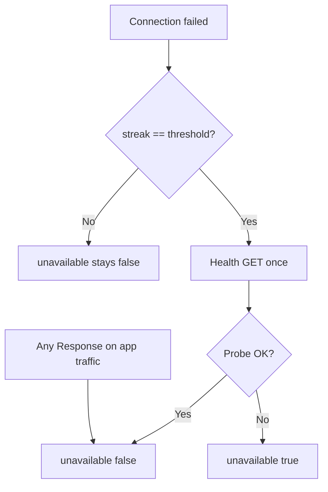

# OCE getting started

### What OCE is

**A network health signal with automatic recovery.**

Read **`OCE.engine.getSnapshot()`** (or **`useOceSnapshot()`**):

| Field | Plain English |
| ----- | ------------- |
| **`unavailable`** | Confirmed “looks offline” **after** streak ≥ threshold **and** health check fails |
| **`streak`** | Consecutive connection failures without a `Response` |
| **`healthContractFailed`** | Optional: health URL answered but failed strict rules |
| **`lastHealthyAt`** | UTC ms of last confirmed healthy observation (`useOceLastHealthyAt()`) |
| (implicit) **available** | `unavailable === false` — recovery toasts fire on `true` → `false` |

- **How it learns:** **`OCE.fetch`** or **`reporter`**. Each settlement: **Response**, **connection failed** (including **`TimeoutError`**), or **ignored** ( **`AbortError`** ).
- **Blip vs outage:** Default threshold **2** — first failure raises **`streak`** only; second failure triggers **one** shared health GET before **`unavailable`** may flip.
- **Automatic recovery:** Any tracked **`Response`** clears **`unavailable`** (404/500 count). No “go online” API. While already offline, fetch recovery is **debounced** (~800ms on idling); **`reporter.reportResponse()`** clears immediately.
- **UX:** `<OceProvider>` toasts; banners via **`useOceUnavailable()`** — never block buttons.



Full scenario diagrams: **[Network flow](/guides/offline-connectivity-engine/network-flow)**.

### What you still own

**OCE.fetch** has the same signature as [`fetch`](https://developer.mozilla.org/en-US/docs/Web/API/fetch). OCE does **not** throw on HTTP 404/500; **you** handle `response.ok` in application code. OCE is **not** a cache, offline queue, or data library.

## New React app (scenario + errors)

**Canonical walkthrough:** `src/lib/oce/README.md` in this repository (mount provider, `loadMe()` helper, connection vs server errors, refresh).

Summary:

1. **`<OceProvider>`** once — toasts for page-wide connectivity transitions.  
2. **`OCE.fetch`** — same as `fetch`; always **`try/catch`** for **could not connect** and check **`res.ok`** for **server errors** (fetch does not throw on 404/500).  
3. **`useOceUnavailable()`** — optional banner; **orthogonal** to your `result.ok` / error state.  
4. User actions **always** call `OCE.fetch` again — never gate on `unavailable`.

```ts
try {
  const res = await OCE.fetch('/api/me', { credentials: 'include' });
  if (!res.ok) {
    // Server answered — OCE still saw a Response
    throw new Error(`HTTP ${res.status}`);
  }
  return await res.json();
} catch (error) {
  // Connection failed — OCE already recorded this (do not call reporter)
  throw error;
}
```

---

## Install surface (idling.app)

```ts
import {
  OCE, // or OfflineConnectivityEngine — same singleton
  OceProvider,
  useOceFetch,
  useOceSnapshot,
  useOceUnavailable,
  useOceReporter,
} from '@lib/oce';

// Unabbreviated naming (identical API):
// import { OfflineConnectivityEngine } from '@lib/oce';
// await OfflineConnectivityEngine.fetch('/api/foo');
```

**Note:** `ConnectivityEngine` (class) is the agnostic core; **`OfflineConnectivityEngine`** / **`OCE`** is the idling.app bootstrapped singleton.

| Export | When to use |
| ------ | ----------- |
| **`OCE.fetch`** | Default — same as `fetch(input, init?)` |
| **`OCE.noCacheFetch`** | Admin, polling, anything that must bypass CDN/browser cache |
| **`OCE.apiFetch`** / **`OCE.apiFetchJson`** | Same-origin `/api` + auth redirect helpers |
| **`<OceProvider>`** | Once in site chrome (toasts) |
| **`useOceUnavailable()`** | Banners — **hint only**, never `disabled={unavailable}` |
| **`useOceReporter()`** | When the request is **not** `fetch` (audio, XHR, native bridge) |

**Global `fetch` is never patched.**

---

## Quick start

OCE is **one function** with the same call shape as **`fetch`**. If you are used to a dedicated HTTP client (axios, ky, etc.), you still call **`OCE.fetch`** — or configure that client’s underlying **`fetch`** to `OCE.fetch` (see [Framework recipes](/guides/offline-connectivity-engine/recipes-index)).

```ts
// axios style (conceptual)
// const { data } = await api.get('/profile');

// OCE — same call pattern as fetch
const response = await OCE.fetch('/api/profile', { credentials: 'include' });
const data = await response.json();
```

```ts
// POST JSON
await OCE.fetch('/api/settings', {
  method: 'POST',
  headers: { 'Content-Type': 'application/json' },
  body: JSON.stringify(payload),
  credentials: 'include',
});
```

```ts
// Helpers (optional — still go through observed fetch)
const json = await OCE.apiFetchJson<Profile>('/profile');
const fresh = await OCE.noCacheFetch('/api/admin/alerts');
```

### React shell

```tsx
// SiteChromeProviders.tsx
import { OceProvider } from '@lib/oce';

export function SiteChromeProviders({ children }: { children: React.ReactNode }) {
  return <OceProvider>{children}</OceProvider>;
}
```

```tsx
// Any client component
import { useOceUnavailable } from '@lib/oce';

export function NetworkHint() {
  const unavailable = useOceUnavailable();
  if (!unavailable) return null;
  return (
    <p role="status" aria-live="polite">
      We are having trouble reaching the network. You can still try your action.
    </p>
  );
}
```

---

## What happens on each request

```text
OCE.fetch(url, init)
  → native fetch (settlements recorded)
  → snapshot updates (streak, unavailable, generation)
  → subscribers / toasts refresh
```

| Outcome | OCE behavior |
| ------- | ------------- |
| **`Response` returned** (any HTTP status, including 4xx/5xx) | **Server answered** — `unavailable=false`, `streak=0` (debounced if was offline) |
| **`fetch` rejects** (DNS, reset, CORS throw, **`TimeoutError`**) | **`streak++`** — still `unavailable=false` if below threshold |
| **`AbortError`** (user cancel, idling SW cache marker) | **Ignored** — no streak change |
| **`streak` ≥ threshold (default **2**)** | **One** shared health GET (`/api/version` on idling) |
| Health probe **fails** (no response / timeout) | Sets **`unavailable=true`** |
| Health probe **succeeds** after a streak | Stays **`unavailable=false`** — blip absorbed |

Details: [Architecture](/guides/offline-connectivity-engine/architecture) · [Configuration](/guides/offline-connectivity-engine/configuration).

---

## Subscribe to state (without React)

```ts
import { OCE } from '@lib/oce';

const engine = OCE.engine;

const off = engine.subscribe(() => {
  const { unavailable, streak, generation } = engine.getSnapshot();
  console.log({ unavailable, streak, generation });
});

// later
off();
```

Prefer **`useOceSnapshot()`** / **`useOceUnavailable()`** in React — they use `useSyncExternalStore` with a stable SSR default.

---

## Manual reporting (when `OCE.fetch` is not used)

Some features never call `fetch` (audio streams, native HTTP). Report the **same three outcomes** the engine would have inferred:

```ts
import { OCE } from '@lib/oce';

const { reporter } = OCE;

// Got an HTTP-equivalent answer (status available)
reporter.reportResponse();

// Network died — no response object
reporter.reportTransportFailure();

// User cancelled — do not treat as outage
reporter.reportIgnored();
```

**Example — HTML audio stream probe** (idling radio widget):

```ts
audio.addEventListener('canplay', () => reporter.reportResponse());
audio.addEventListener('error', () => reporter.reportTransportFailure());
```

Full rules: [Reporter port](/guides/offline-connectivity-engine/reporter).

---

## Framework recipes (top 10)

Full matrix with copy-paste examples: **[Framework recipes index](/guides/offline-connectivity-engine/recipes-index)**.

| | |
|---|---|
| Native `fetch`, Axios, TanStack Query, SWR, Apollo | RTK Query, ky, ofetch, urql, tRPC |

Minimal data-library pattern:

```ts
import { OCE } from '@lib/oce';

useQuery({
  queryKey: ['user'],
  queryFn: () => OCE.fetch('/api/user').then((r) => r.json()),
  networkMode: 'always',
});
```

---

## Rules (non‑negotiable)

1. **Do not block UI** on `unavailable` — no `disabled={unavailable}`, no skipping `fetch` because the flag is true ([MDN `onLine` guidance](https://developer.mozilla.org/en-US/docs/Web/API/Navigator/onLine)).
2. **Do not patch `globalThis.fetch`.**
3. **Use `OCE.fetch` for same-origin API** you want reflected in connectivity hints (admin pages still migrating — see [Market landscape](/guides/offline-connectivity-engine/market-landscape)).
4. **One engine per page** — on idling, that is `OCE.engine`.

---

## Agnostic host (not idling.app)

```ts
import { ConnectivityEngine } from '@your-scope/connectivity';

const native = globalThis.fetch.bind(globalThis);
const engine = new ConnectivityEngine({
  healthCheckUrl: '/api/version',
  baseFetch: native,
});

export const appFetch = engine.fetch(native);
// call sites: await appFetch(url, init)
```

Idling equivalent: **`import { OCE } from '@lib/oce'`** — bootstrap is already done in `OCE.ts`.

---

## Where to go next

| Doc | Topic |
| --- | ----- |
| [Overview](/guides/offline-connectivity-engine) | Signal vs promise, down/up paths |
| [Market landscape](/guides/offline-connectivity-engine/market-landscape) | vs Query, SWR, Workbox, queues |
| [Attach fetch](/guides/offline-connectivity-engine/attach-fetch) | Host + embed wiring |
| [React](/guides/offline-connectivity-engine/react) | Hooks, banners, testing |
| [Edge cases](/guides/offline-connectivity-engine/edge-cases) | SW cache, captive portal, CORS |

**Implementation:** `src/lib/oce/` · [`OCE.ts`](https://github.com/idling-app/idling.app/tree/main/src/lib/oce) (paths match this repo layout).