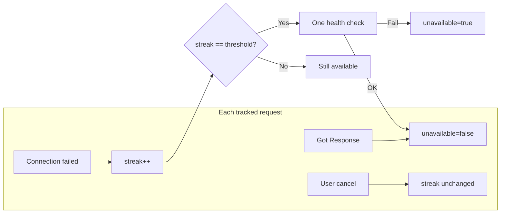

# Offline Connectivity Engine (OCE)

## What OCE is and does

**OCE is a network health signal that recovers on its own.**

It publishes a **snapshot** (not a single hidden bit): chiefly **`unavailable`**, plus **`streak`**, **`failureThreshold`**, **`generation`**, and sometimes **`healthContractFailed`** when the health URL answered but failed your rules. **`useOceUnavailable()`** is the simple banner hook; **`useOceSnapshot()`** exposes the full row.

1. **Confirmed offline** — **`unavailable: true`** only after **`failureThreshold`** consecutive **connection failures** (default **2**) **and** a shared health GET fails (on idling: **`/api/version`**). One failure alone is a **blip**: higher **`streak`**, still **`unavailable: false`**, **no** health call.
2. **How it learns** — HTTP through **`OCE.fetch`** or **`OCE.reporter`**. **`online`/`offline` events** trigger health verify; OCE does **not** trust **`navigator.onLine`** alone ([MDN](https://developer.mozilla.org/en-US/docs/Web/API/Navigator/onLine)).
3. **`lastHealthyAt`** — UTC ms in **`useOceSnapshot()`** / **`useOceLastHealthyAt()`** when connectivity was last **confirmed** healthy.
4. **Gets better (automatic)** — Any tracked **`Response`** — including 404, 500, or a **successful health check after a streak** — sets **`unavailable: false`** and clears **`streak`**. No “reconnect” API. While **`unavailable`**, fetch **`Response`** recovery is **debounced** (idling default **800ms**); **`reporter.reportResponse()`** is immediate.
5. **UX** — Banners and `<OceProvider>` toasts (“Network trouble” / “Back online”; different copy when **`healthContractFailed`**). **Do not** disable actions when **`unavailable`** is true.
6. **Timeouts** — **`TimeoutError`** on user traffic or on the health probe counts as **connection failed**; **`AbortError`** (cancel) does **not** increment **`streak`**.

**Scenario walkthroughs (single blip, double fail + probe, recovery, timeouts):** [Network flow](/guides/offline-connectivity-engine/network-flow).

OCE does **not** save requests for later, retry your APIs, or replace your “not found / server error” messages.

| Plain English | Snapshot |
| ------------- | -------- |
| **Server answered** | Recover: **`unavailable=false`**, **`streak=0`** |
| **No response** (incl. timeout) | **`streak`** rises; may trigger health confirm |
| **Health check failed** | **`unavailable=true`** |
| **Health answered but wrong shape** (optional config) | **`unavailable=true`**, **`healthContractFailed=true`** |
| **HTTP 4xx/5xx** | Still a **Response** — your UI handles it; OCE treats as connected |

**Start here:** [Getting started](/guides/offline-connectivity-engine/getting-started) · **Tutorial with errors:** `src/lib/oce/README.md`

**Idling.app:** import **`OCE`** from `@lib/oce` (`OfflineConnectivityEngine` is the same object).

## Non-blocking rule

`OCE.fetch` **always** runs the real request. Never block forms or hide buttons because `unavailable` is true.

## One engine per page

On idling.app, everyone shares **`OCE.engine`**. Other apps can host their own `ConnectivityEngine` the same way.

## Guide map

| Page | Topic |
| ---- | ----- |
| [**Getting started**](/guides/offline-connectivity-engine/getting-started) | Install, examples, recovery |
| [**Network flow**](/guides/offline-connectivity-engine/network-flow) | Snapshot fields, mermaid scenarios, timeouts |
| [**Framework recipes ×10**](/guides/offline-connectivity-engine/recipes-index) | Axios, TanStack Query, SWR, … |
| [Market landscape](/guides/offline-connectivity-engine/market-landscape) | Compared to other tools |
| [Architecture](/guides/offline-connectivity-engine/architecture) | How the engine works (technical) |
| [Reporter](/guides/offline-connectivity-engine/reporter) | Audio / XHR / non-`fetch` |
| [Edge cases](/guides/offline-connectivity-engine/edge-cases) | Caches, captive Wi‑Fi, etc. |