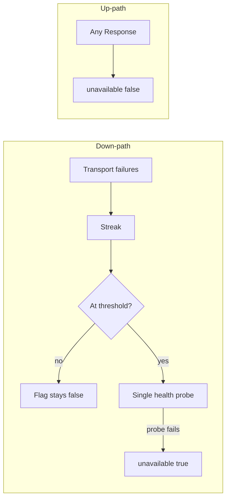

# Offline Connectivity Engine (OCE)

**In plain terms:** OCE watches what your HTTP transport actually did and publishes a single page-wide hint: `unavailable: boolean`. Any app attaches it to **whatever fetch it already uses**. Import the engine from **`@strixun/api-framework/connectivity`** (not a separate package). `@strixun/api-framework`'s `secureFetch` is one such attachment, not the owner of the idea.

The flag is a **best-effort guess**, not a promise. Wi‑Fi can be associated with no route. A captive portal can return HTML. CORS failures look like dropped packets. A cached service-worker response can look like the origin answered.

## Signal vs promise

| Concept | OCE contract |
| ------- | ------------- |
| **Signal** | `getSnapshot().unavailable` — use for banners, status text, metrics, background retry pacing |
| **Promise** | Treating the flag as “the network will fail/succeed” — **out of contract** |

[MDN `Navigator.onLine`](https://developer.mozilla.org/en-US/docs/Web/API/Navigator/onLine) documents that the property is **inherently unreliable** (LAN association, virtual adapters, firewall quirks). MDN explicitly recommends you **should not disable features based on it, only hint**. OCE does not read `navigator.onLine`; it learns only from real transport outcomes and an optional same-origin health probe.

## Non-blocking rule

The wrapped fetch **always** calls the underlying `baseFetch`. The UI must **not** disable actions or skip the next request because `unavailable` is true.

```tsx
// Forbidden — do not gate user work on the flag
if (snapshot.unavailable) {
  return;
}
button.disabled = snapshot.unavailable;
```

```tsx
// Allowed — hint only
{snapshot.unavailable ? (
  <StatusBanner>Connection may be unavailable. You can still try again.</StatusBanner>
) : null}
```

`OfflineQueue` (and similar) may delay **background** flush while `unavailable`, but **must** still run user-initiated sends.

## Down-path vs up-path

Understanding when the flag turns **on** versus **off** avoids surprise UX.

### Down-path (becoming unavailable)

1. Transport failures (`TypeError`, DNS, connection drop, CORS/CSP/mixed content, `TimeoutError`) increment a **streak**.
2. Below `failureThreshold` (default **2**), the streak is tracked but **`unavailable` stays false** and **no probe runs**.
3. At the threshold, **one** shared health-check runs (single-flight). If that confirm step fails transport → `unavailable = true`.
4. Any `Response` on ordinary traffic **does not** trigger a probe on that path.

### Up-path (clearing unavailable)

1. The **next real `Response`** (any status, including `opaque`) clears the flag: `unavailable = false`, streak `0`, generation bumps.
2. **No** second health-check is required to “verify we are back.”
3. A slow probe in flight is **discarded** if recovery already bumped **generation**.



## One engine per page

Microfrontends and the host share **one** engine via `getPageConnectivityEngine()` and `globalThis[Symbol.for("@strixun/oce")]`. The host attaches fetch **once** before remotes render; remotes subscribe only.

## Guide map

| Page | Topic |
| ---- | ----- |
| [Architecture](/guides/offline-connectivity-engine/architecture) | CLAD seams, singleton, generation, single-flight probe |
| [Configuration](/guides/offline-connectivity-engine/configuration) | `failureThreshold`, `healthCheckUrl`, probe presets, optional 204 |
| [Attach fetch](/guides/offline-connectivity-engine/attach-fetch) | Host, microfrontends, `secureFetch` |
| [Reporter](/guides/offline-connectivity-engine/reporter) | Non-fetch HTTP stacks |
| [React](/guides/offline-connectivity-engine/react) | `useSyncExternalStore` hint pattern |
| [Recipes](/guides/offline-connectivity-engine/recipes-fetch) | Fetch, Axios, TanStack Query, Apollo, SWR |
| [Framework deadlocks](/guides/offline-connectivity-engine/framework-deadlocks) | Pause / continue / ignore swallowing |
| [Edge cases](/guides/offline-connectivity-engine/edge-cases) | Wi‑Fi, portals, SW cache, CORS, parallel failures |

---

**Sources (specified):** Offline Connectivity Engine plan — `getPageConnectivityEngine`, `attachFetch`, generation token, probe deadline presets, FR-OCE-001..010.