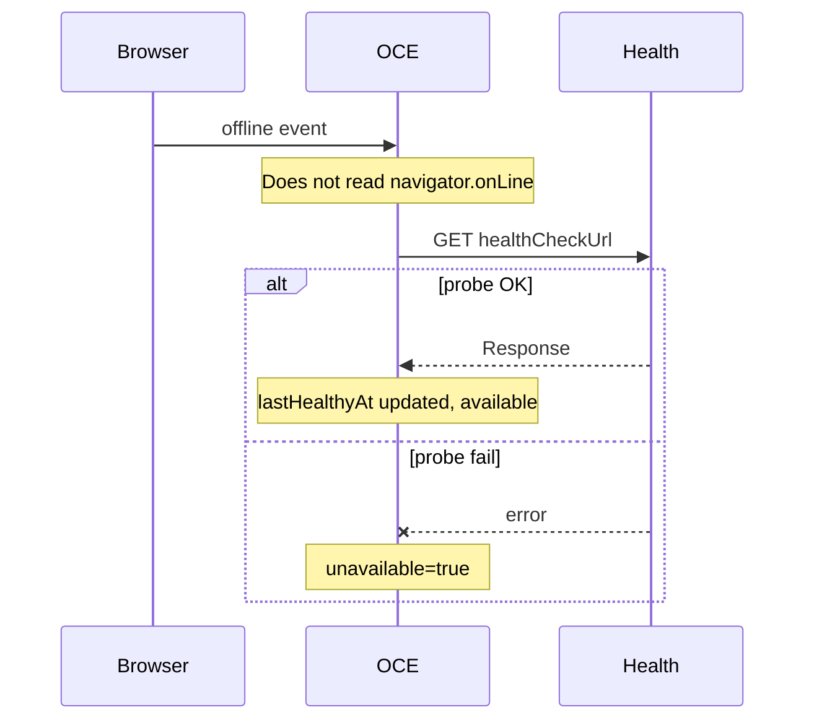
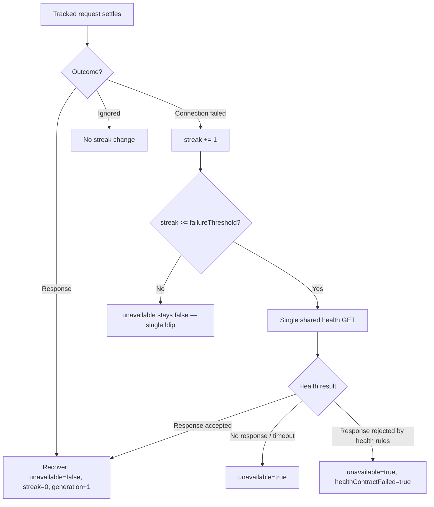
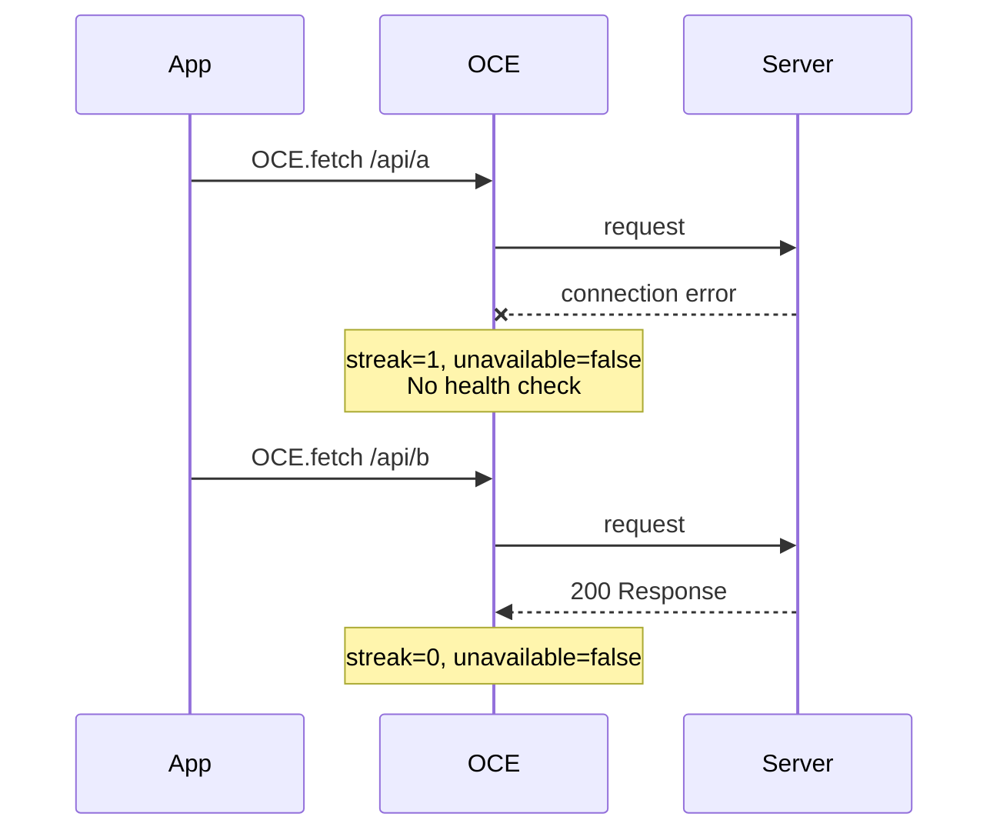
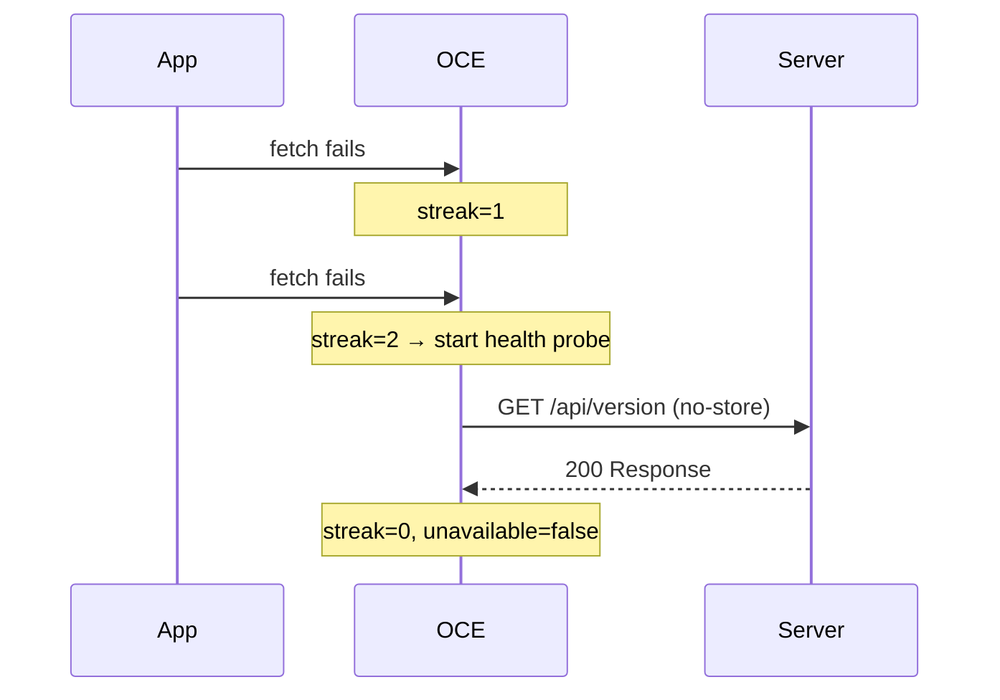
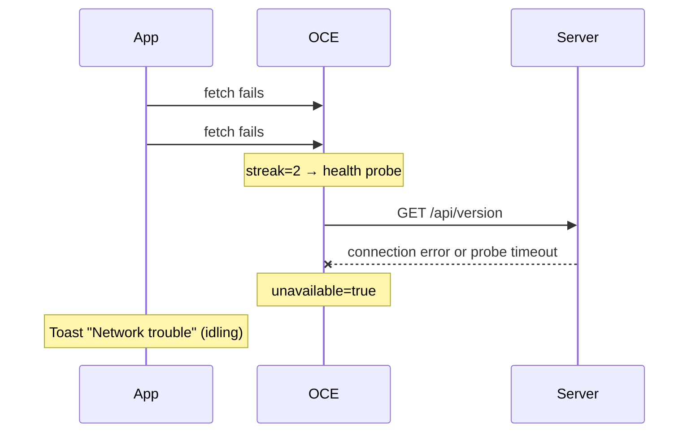
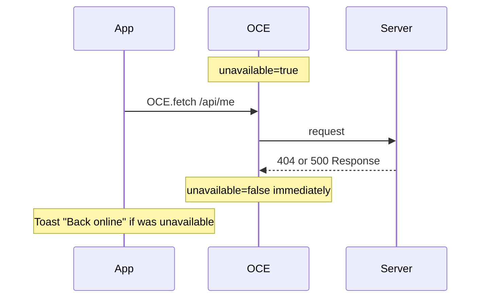
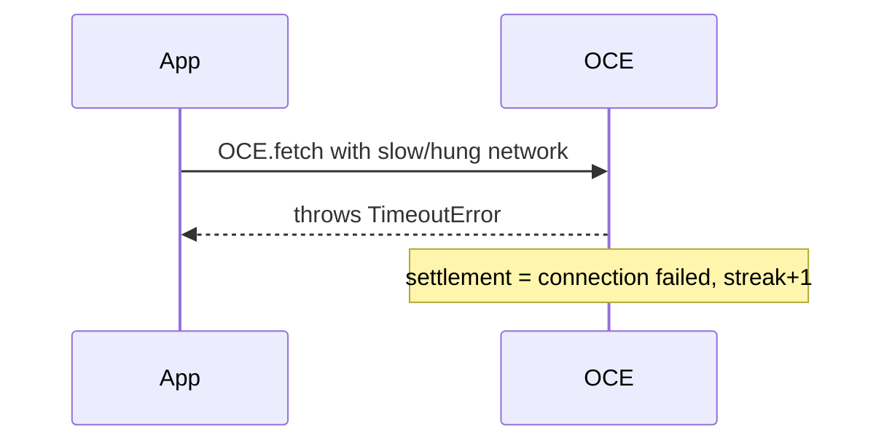

# Network flow and scenarios

**In plain terms:** OCE does **not** expose one mystery boolean. It keeps a small **snapshot** on each update. The main user hint is **`unavailable`**, but **`streak`**, optional **`healthContractFailed`**, and **`generation`** explain *why* and help ignore stale results.

## What `getSnapshot()` reports

| Field | Audience | Meaning |
| ----- | -------- | ------- |
| **`unavailable`** | Banners, toasts, `useOceUnavailable()` | **Confirmed** “we look offline” — only after the failure **streak** hits the threshold **and** the health check **fails** (or health rules fail). Between the second failure and probe finish, this can still be `false`. |
| **`streak`** | Advanced UI, debugging | Consecutive **connection failures** (no `Response`) at the current **`generation`**. Resets to `0` on any successful `Response`. |
| **`failureThreshold`** | Docs / tuning | How many consecutive failures trigger a health confirm (default **`2`** on idling.app). |
| **`generation`** | Internal / tests | Bumps on recovery; stale settlements from an older wave are ignored. |
| **`healthContractFailed`** (optional) | Toasts, custom copy | Health URL **answered**, but your **`interpretHealthResponse`** said it is not good enough (e.g. captive-portal **204-only** mode). Implies **`unavailable: true`** with a different message on idling.app. |
| **`lastHealthyAt`** | Metrics, “last good” UI | UTC **ms** when connectivity was last **confirmed** healthy (`Response` or successful health verify). `null` until the first confirmation this session. **`useOceLastHealthyAt()`** on idling.app. |

**“Available”** is not a separate field — it means **`unavailable === false`**. `<OceProvider>` shows **“Back online”** when `unavailable` flips from `true` → `false`.

Hooks:

- **`useOceUnavailable()`** — `unavailable` only (banner).
- **`useOceSnapshot()`** — full row above (including `healthContractFailed`).

Idling default health URL: **`/api/version`**. Default health rule: **any `Response` counts as OK** (no `healthContractFailed` unless you opt into stricter config — see [Configuration](/guides/offline-connectivity-engine/configuration)).

## `navigator.onLine` (events only — not the boolean)

[MDN](https://developer.mozilla.org/en-US/docs/Web/API/Navigator/onLine) warns **`navigator.onLine` is unreliable** (especially when `true`). OCE **does not** poll or trust that property.

On idling.app the host attaches **`online`** and **`offline`** listeners. Each event triggers the **same health GET** used for streak confirm — outcomes update **`unavailable`**, **`lastHealthyAt`**, and related fields:

| Event | Health probe succeeds | Health probe fails |
| ----- | --------------------- | ------------------ |
| **`offline`** | Stay available (browser hint was wrong) — **`lastHealthyAt`** updates | **`unavailable: true`** (strong hint + failed verify) |
| **`online`** | Recover — **`lastHealthyAt`** updates | Soft signal: **`streak++`**; **`unavailable`** only if already at threshold |

Disable with `listenToNavigatorOnLine: false` on `ConnectivityEngine` config.

---

## High-level loop

Every tracked call (`OCE.fetch` or `reporter`) ends in one of three outcomes:

1. **`response`** — server sent something back → **recover immediately** (`unavailable = false`, `streak = 0`).
2. **Connection failed** — no `Response` (DNS, reset, **`TimeoutError`**, …) → **`streak += 1`**; maybe run **one** health confirm.
3. **`ignored`** — user cancel (`AbortError`), or idling SW cache marker → **no streak change**.

**Important:** A lone failure (streak **1** when threshold is **2**) does **not** run the health URL and does **not** set **`unavailable`**.

---

## Scenario: single blip (one failure, then OK)

Default threshold **2**. First failure only raises **`streak`**.

---

## Scenario: two failures, health check **succeeds** (stay “available”)

Two consecutive failures trigger **one** confirm probe. If the probe gets an acceptable **`Response`**, the page **never** flips **`unavailable: true`**.

---

## Scenario: two failures, health check **fails** → unavailable

While the probe is in flight after the second failure, **`unavailable`** may still be **`false`** briefly — the confirm step is what **commits** “we look offline.”

---

## Scenario: recovery from ordinary traffic

Any tracked **`Response`** clears the flag — **no** “I’m back” API, **no** health call required on that path.

HTTP errors are still **responses** — your app shows “not found” / “server error”; OCE treats them as **connected**.

---

## Scenario: timeouts

| Source | Handled? | Effect |
| ------ | -------- | ------ |
| User request throws **`TimeoutError`** | Yes | Counts as **connection failed** → increments **`streak`** (see FR-OCE-005 tests). |
| User **`AbortError`** (cancel) | Yes | **`ignored`** — does not increment streak. |
| Engine health probe | Yes | Uses **`AbortSignal.timeout`** preset (`Interactive` = 5s on idling default); probe **`TimeoutError`** → failed confirm → **`unavailable: true`**. |

Your own `AbortSignal.timeout` on **`OCE.fetch`** is classified the same way when the runtime surfaces **`TimeoutError`**.

---

## Scenario: health answered but contract failed (optional)

When **`interpretHealthResponse(response)`** returns **`false`** (strict portal / 204-only mode), OCE sets **`unavailable: true`** and **`healthContractFailed: true`**. Idling toasts use slightly different copy (“trouble **verifying** connectivity”).

Default idling bootstrap does **not** enable strict mode — any probe **`Response`** clears suspicion.

---

## Scenario: parallel failures at threshold

Many remotes failing together still produce **one** shared probe (single-flight). Late settlements after recovery are dropped via **`generation`**.

See [Architecture](/guides/offline-connectivity-engine/architecture) and [Edge cases](/guides/offline-connectivity-engine/edge-cases).

---

**Related:** [Getting started](/guides/offline-connectivity-engine/getting-started) · [Configuration](/guides/offline-connectivity-engine/configuration) · `src/lib/oce/connectivity/connectivity.engine.test.ts`