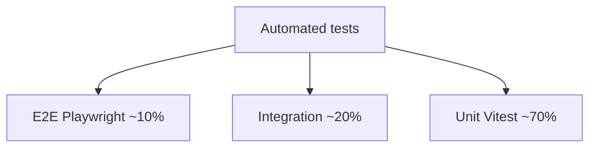

# Testing

**In plain terms:** fast checks run with **Vitest**; browser journeys run with **Playwright**. There is no Jest runner in this repository.

## Test pyramid (team default)



## Unit and integration (Vitest)

```bash
pnpm test              # single run
pnpm test:watch        # watch mode
pnpm test:coverage     # coverage report
pnpm test:ci           # CI entry (vitest run)
```

Configuration: `vitest.config.ts` at repo root. Prefer meaningful tests with real fixtures — see `.cursor/skills/meaningful-unit-tests/SKILL.md` in the repo.

### Trace IDs

When a test maps to `requirements-registry.yaml`, tag descriptions with trace IDs, e.g. `test('[FR-001] shows loading state', ...)`. Details: [Traceability](/philosophy/traceability).

## End-to-end (Playwright)

```bash
pnpm e2e:headless
pnpm e2e:headed
pnpm e2e                # UI mode
pnpm e2e:reports        # open HTML report
```

Docker E2E: `pnpm e2e:docker` when the stack is up.

## What we do not use

- **Jest** — not configured; do not add `jest.config.js` or `jest.mock` patterns here.
- **React Testing Library via Jest** — use Vitest's compatible test API instead.

## Co-located stub

`src/lib/testing.md` is a bootstrap neighbor and may lag behind this page. **Trust this guide and `package.json` scripts.**

Legacy repo-root `TESTING.md` should point here; if it still describes Jest, treat it as deprecated.

---

**Sources:** `package.json` (`test`, `test:watch`, `e2e:*`), `vitest.config.ts`, Playwright config at repo root