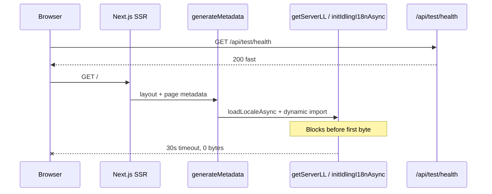

# SSR metadata and i18n gotcha

**What this page is about:** A real production outage where the site looked “down” for hours while the health API stayed fine. The failure was **server-side metadata** loading huge locale files — not the client language picker.

## What went wrong (plain English)

Think of every page request as two doors:

1. **Door A — metadata** (title, Open Graph, etc.): Next.js runs this **before** it can send the first byte of HTML.
2. **Door B — the page UI** (header, home content, client React): runs after Door A.

We wired **full localization** into Door A: `generateMetadata` → `getServerLL()` → `initIdlingI18nAsync(locale)`. That **downloads/parses multi‑megabyte locale JSON on the Node server** (often twice per request: root layout + page). With a non‑English cookie or slow chunk I/O, the server **sent 0 bytes for 30+ seconds**. The browser showed a blank hang; React never got a chance to run.

**Meanwhile** `/api/test/health` never opens Door A — so ops thought “the app is up” while every marketing page was dead.

Client-only fixes (provider bus, quote shards, `Accept-Language`, etc.) **cannot** fix a request that never starts streaming HTML.



## Symptoms we saw

| Signal | Typical value | Meaning |
|--------|---------------|---------|
| `GET /api/test/health` | 200, &lt; 1s | App process healthy |
| `GET /` | `time_starttransfer=0`, 0 bytes, 25–30s timeout | Stuck in metadata / SSR, not client |
| Local `next dev` | Often “fine” | Dev bundles differ; prod code-splits locales |
| Client errors | “Connection closed”, re-render storms | **After** paint — separate from 0-byte TTFB |

Quick prod check (Windows):

```bash
curl.exe -sS -w "start=%{time_starttransfer}s total=%{time_total}s code=%{http_code}\n" -o NUL --max-time 15 https://idling.app/
curl.exe -sS -w "health code=%{http_code} time=%{time_total}s\n" -o NUL --max-time 10 https://idling.app/api/test/health
```

Healthy: home **start** and **total** are a few seconds, not `start=0` with a timeout.

## Root defects (do not reintroduce)

### 1. Async locale load in metadata (primary)

**Bad (caused outage):**

- `export async function generateMetadata()` on **root** `layout.tsx` and hot routes (`page.tsx`, etc.)
- `getServerLL()` calling `await initIdlingI18nAsync(locale)` or `loadLocaleAsync`
- `resolveServerIdlingLocale()` using **`Accept-Language`** or **locale cookie** for metadata (any non-`en` → huge import)

**Good (current policy):**

- **Static** metadata on shell routes: `export const metadata = { ...buildRootSiteMetadata(), ... }` from [`META_EN`](../i18n-en-catalog/meta.en.ts) via [`idlingMeta.ts`](../molecules/i18n/idlingMeta.ts)
- [`getServerLL()`](./idling-server-i18n.ts): **sync** `initIdlingI18n('en')` only — bundled English via [`idling-sync-en.ts`](./idling-sync-en.ts)
- Localized UI: **client only** via [`IdlingLocaleProvider`](../app/components/locale/IdlingLocaleProvider.tsx)

### 2. Client provider blocking the shell (secondary)

**Bad:**

- `useEffect([localeId])` that always runs `loadLocaleAsync('en')` + `loadLocaleAsync(target)` on every navigation
- `resolveIdlingLocale()` on mount (storage **+ navigator**) then immediately setting `localeId` before chunks load
- Global `notify*` / `localeRevision` forcing full-tree remounts

**Good:** Sync English first paint; async locales only on picker or **deferred** `localStorage` (storage only, not navigator). See [Site localization overview](../../docs/i18n.md) § Runtime.

### 3. Duplicate SSR `auth()` (minor)

**Bad:** `Nav`, `NavAuth`, and `AuthAvatarServer` each calling `await auth()` on every page.

**Good:** `Nav` calls `auth()` once and passes `session` into children.

## Forbidden vs allowed (server metadata)

| Do not | Do instead |
|--------|------------|
| `async generateMetadata` + `getServerLL()` on root layout / home | `export const metadata` + `buildRootSiteMetadata()` |
| `initIdlingI18nAsync` in `idling-server-i18n.ts` | `initIdlingI18n('en')` sync |
| Cookie / Accept-Language for metadata locale | `META_EN` or sync English `getServerLL()` |
| “Fix prod” by only changing `IdlingLocaleProvider` | Fix **server** metadata path first; verify TTFB |

Dynamic metadata is still allowed when it **does not** async-import locale shards (e.g. profile metadata that hits Postgres only on `/profile/*`).

## Files that must stay aligned

| File | Contract |
|------|----------|
| [`layout.tsx`](../app/layout.tsx) | `export const metadata` — no async metadata |
| [`page.tsx`](../app/page.tsx) | `export const metadata = buildHomePageMetadata()` |
| [`idling-server-i18n.ts`](./idling-server-i18n.ts) | Sync English only |
| [`idlingMeta.ts`](../molecules/i18n/idlingMeta.ts) | `buildRootSiteMetadata()` uses `META_EN`, not async locale |
| [`IdlingLocaleProvider.tsx`](../app/components/locale/IdlingLocaleProvider.tsx) | Nonblocking client orchestration |

## Related merges (history)

Incident fixes landed across **#365–#375**. Partial client-only PRs left prod broken until **static metadata + sync server `getServerLL`** shipped (#375). Do not “revert to generateMetadata for translated titles” without an approved server i18n design that avoids `loadLocaleAsync` on the critical path.

## When adding localized page titles later

1. Keep **shell** metadata English/static.
2. Prototype **one** route with measured TTFB under production-like build (`pnpm exec next build --webpack`).
3. Never use `loadLocaleAsync` in root layout metadata.
4. Update this page and [`.cursor/rules/i18n-ssr-metadata.mdc`](../../.cursor/rules/i18n-ssr-metadata.mdc) if the design changes.

## Cross-links

- [Site localization overview](/guides/i18n)
- [Message ticker](/app/components/message-ticker/MessageTicker) (client-only quote shards)