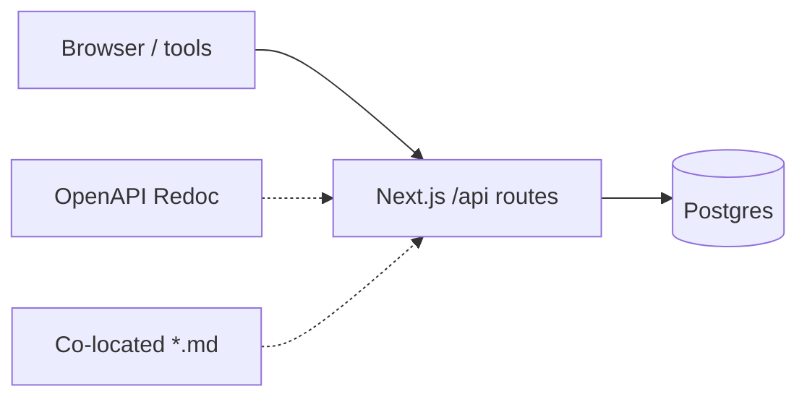

# API overview (truth pass)

**In plain terms:** treat [**OpenAPI at `/api/`**](/api/) as the machine contract. This page maps **feature areas** to handlers and co-located markdown neighbors under `src/app/api/`.

## Base URLs

| Environment | Base |
| ----------- | ---- |
| Development | `http://localhost:3000/api` |
| Production | `https://idling.app/api` |

**Handler count (audited):** 60 `route.ts` + 4 `route.tsx` files under `src/app/api/` (NextAuth catch-all counts as one module).

## Authentication

| Surface | Module |
| ------- | ------ |
| NextAuth | `src/app/api/auth/[...nextauth]/route.ts` |
| Unlink account | `src/app/api/auth/unlink-account/route.ts` |
| Session permissions | `src/app/api/auth/permissions/route.ts` |

Admin routes use `requireAdminApiAccess` / `withPermissions` patterns — see co-located admin docs below.

## Feature → HTTP map

### Idling tools (this hub)

| Feature | Methods | Co-located doc |
| ------- | ------- | -------------- |
| Card generator / OG SVG | `GET /api/og-image`, `GET /api/og-image/[id]` | [/app/api/og-image/index](/app/api/og-image/index), [/app/api/og-image/services/OGImageService](/app/api/og-image/services/OGImageService) |
| SVG → PNG | `GET`, `POST /api/svg-to-png` | [/app/api/svg-to-png/route](/app/api/svg-to-png/route) |
| Radio catalog | `GET /api/radio/stations` | [/app/api/radio/stations/route](/app/api/radio/stations/route) |
| Radio playlist resolve | `GET /api/radio/playlist` | [/app/api/radio/playlist/route](/app/api/radio/playlist/route) |
| Radio now playing | `GET /api/radio/now-playing` | [/app/api/radio/now-playing/route](/app/api/radio/now-playing/route) |
| Image upload | `POST /api/upload/image` | [/app/api/upload/image/index](/app/api/upload/image/index) |
| Form options (admin) | `GET/POST/DELETE /api/form-options` | `src/app/api/form-options/route.ts` (neighbor stub may lag) |

### Social & profile

| Area | Examples | Co-located |
| ---- | -------- | ---------- |
| Profile | `/api/profile/[username]`, `/api/profile/id/[id]` | `src/app/api/profile/[username]/route.md` (co-located) |
| Users | `/api/users/search`, `/api/users/batch-decorations` | `route.ts` neighbors |
| Emojis | `/api/emojis`, `/api/emojis/usage` | [/app/api/emojis/index](/app/api/emojis/index) |
| Link preview | `GET /api/link-preview` | [/app/api/link-preview/index](/app/api/link-preview/index) |
| Avatar render | `GET /api/avatar-image` | [/app/api/avatar-image/index](/app/api/avatar-image/index) |

### Admin

| Area | Prefix | Index |
| ---- | ------ | ----- |
| Users & roles | `/api/admin/users`, `assign-role`, `timeout` | [/app/api/admin/users/route](/app/api/admin/users/route) |
| Permissions | `/api/admin/permissions`, `roles` | [/app/api/admin/permissions/route](/app/api/admin/permissions/route) |
| Quotas | `/api/admin/quotas/global`, per-user overrides | [/app/api/admin/quotas/global/index](/app/api/admin/quotas/global/index) |
| Subscriptions | plans, user-subscriptions, stats | `src/app/api/admin/subscription-plans/route.ts` |
| Alerts & emojis | `/api/admin/alerts`, `/api/admin/emojis` | co-located neighbors |
| Rate limit ops | `/api/admin/rate-limit`, `test-rate-limit` | `route.ts` |

Human admin charter (partially emoji-heavy; verify against `route.ts`): [/app/api/admin](/app/api/admin).

### Analytics, streams, subscription

| Route | Role |
| ----- | ---- |
| `POST /api/analytics/collect` | Beacon ingest |
| `GET /api/analytics/dashboard` | Dashboard aggregates |
| `GET /api/streams/live-status` | Live stream flags |
| `GET /api/subscription/status` | User subscription |
| `GET/POST /api/user-subscriptions` | Self-serve subscription rows |

### Meta & health

| Route | Role |
| ----- | ---- |
| `GET /api/version` | Build/version JSON |
| `GET /api/openapi` | OpenAPI JSON source |
| `GET /api/swagger` | Swagger UI JSON proxy |
| `GET /api/test/health` | Health probe |
| `GET /api/test-sse` | SSE smoke test |

## Removed fiction

- **No** public `/api/users` CRUD list — user administration is under **`/api/admin/users`** with permission gates.
- **No** Elasticsearch-backed search API in this application.
- Co-located [`src/app/api/index.md`](/app/api/index) intentionally redirects readers here — do not resurrect fictional user CRUD tables.

## Interactive docs

| Resource | URL on docs site |
| -------- | ---------------- |
| Redoc (OpenAPI) | [/api/](/api/) |
| Swagger JSON route | Running app: `/api/swagger` |
| Regenerate spec | `pnpm docs:openapi` |

## Rate limiting

Many public routes wrap handlers with `withRateLimit` (radio, og-image, etc.). Service implementation: `src/lib/middleware/withRateLimit.ts` — co-located doc under `src/lib/services/` when audited.

## Related hub pages

- [Radio](/idling/radio)
- [Card generator](/idling/card-generator)
- [SVG converter](/idling/svg-converter)
- [Rate limiting](/lib/services/RateLimitService) (when neighbor is audited)

---

**Sources:** `src/app/api/**/route.ts`, `src/app/api/**/route.tsx`, `src/app/api/openapi.json`, `src/app/api/index.md`, `src/idling/api-overview.md` (prior truth pass), `docusaurus.config.js` (Redoc mount)