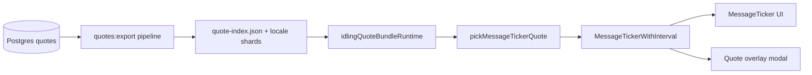

# Quotes and message ticker

**What this is:** the site header **message ticker** rotates quote lines from a **static indexed bundle** shipped in the client bundle (`src/data/quotes/`). The ticker does **not** call live quote HTTP APIs at runtime.

OG image generation is separate: `QuoteService` in the card pipeline can fetch external quote APIs with weighted round-robin (`src/app/api/og-image/services/QuoteService.ts`) — that path is **not** the message ticker.

## On-disk bundle

| Artifact | Path |
| -------- | ---- |
| Index | `src/data/quotes/quote-index.json` |
| English corpus | `src/data/quotes/corpus.en.json` |
| Locale shards | `src/data/quotes/locales/{en,de,fr,…}.json` |
| Translation meta | `src/data/quotes/quote-translation-meta.json` |

Importer/runtime modules:

- `src/molecules/quotes/idlingQuoteBundleRuntime.ts` (client)
- `src/molecules/quotes/idlingQuoteBundleRuntime.server.ts` (server actions)
- `src/molecules/quotes/idlingQuoteBundleCore.ts` — shared types/loaders
- `src/molecules/quotes/pickMessageTickerQuote.ts` — selection policy

Canon types: `IdlingQuoteRecord`, `MessageTickerQuotePayload` under `src/molecules/quotes/`.

## Data path (ticker)

Operator maintenance scripts (repo `package.json`): `quotes:harvest`, `quotes:export`, `quotes:import-db`, `quotes:translate` — refresh DB → export → shards before release. There is **no** `src/app/api/internal/quotes/` route tree in this repository as of the last audit.

## Client flow (`MessageTickerWithInterval.tsx`)

1. `useIdlingLocale()` supplies `localeId` and `ll` for empty state + separators.
2. `ensureQuoteBundleReady` / `ensureQuoteLocaleShard` load the shard for the active locale (async; English has a sync fast path in bundle core).
3. `pickMessageTickerQuote(localeId, separator)` chooses the next `MessageTickerQuotePayload`.
4. `formatTickerLine` + `ll` build the visible string passed to `MessageTicker`.
5. Click opens overlay via `openMessageTickerQuoteOverlay`, `buildMessageTickerQuoteOverlayViewModel`, and `OverlayContext`.

Server-side random quote for actions: `tickerActions.ts` → `getRandomQuoteFromBundleServer`.

## i18n

Ticker chrome uses typesafe-i18n keys (`ll.messageTicker.*`). Locale list is the **canon molecule** `IDLING_LOCALE_CATALOG` in `src/molecules/quotes/idlingLocaleCatalog.ts` (rows from `src/i18n/supported-locales.json`). Footer picker + `idling-ui-locale` storage must stay aligned — see [/guides/i18n](/guides/i18n).

## SSR note

Quote **UI** is client-only. Do not load locale JSON shards in root `generateMetadata` — see [/guides/i18n-ssr-metadata](/guides/i18n-ssr-metadata).

## Operator troubleshooting

| Symptom | Check |
| ------- | ----- |
| Empty ticker | Shard missing for locale — run export or `l10n:refresh:sync-en` |
| Wrong language body | `src/data/quotes/locales/<id>.json` vs picker `localeId` |
| Stale lines after DB edit | Re-run `quotes:export` and redeploy |
| Overlay missing attribution | `MessageTickerQuotePayload` fields in `messageTickerQuotePayload.ts` |

## Related

- [Internationalization](/guides/i18n)
- Repo-root `docs/quotes/` and `docs/message-ticker.md` (not all mirrored in Docusaurus yet)

---

**Sources:** `src/app/components/message-ticker/MessageTickerWithInterval.tsx`, `src/molecules/quotes/pickMessageTickerQuote.ts`, `src/molecules/quotes/idlingQuoteBundleRuntime.ts`, `src/data/quotes/quote-index.json`, `package.json` (`quotes:*` scripts)