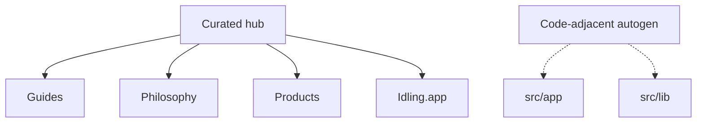
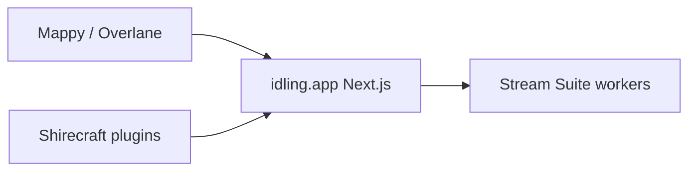

# Idling.app documentation hub

Think of this site as the **map room** for the whole idling.app workspace: the social site itself, the Stream Suite services, desktop tools, and Minecraft plugins. Co-located markdown still lives next to source files for coverage tooling, but **humans start here** — curated guides, philosophy, and product families with working links.

## What this page is about

**Audience:** developers, operators, and curious contributors who need accurate stack facts (not bootstrap stubs that mention Jest or Yarn by mistake).

## Quick links

| Section | What you get |
| ------- | ------------ |
| [Getting started](/guides/getting-started) | pnpm, Node 22+, Docker dev, docs on port 3001 |
| [Stack & tooling](/guides/stack) | Next.js 16, Vitest, Playwright, CSS modules |
| [Testing](/guides/testing) | Unit, coverage, and E2E commands |
| [Internationalization](/guides/i18n) | typesafe-i18n, LibreTranslate, SSR metadata rules |
| [CLAD philosophy](/philosophy/clad) | Composable Layered Agnostic Design (adapted hub edition) |
| [Product ensemble](/products) | Every shipped or marketed product with repo pointers |
| [Idling.app features](/idling) | Radio, PWA, quotes, real API surface |
| [API Reference](/api/) | OpenAPI (Redoc) — source of truth for HTTP routes |
| [Coverage honesty](/guides/documentation-coverage) | Stub neighbors vs hand-written hub pages |

## Documentation coverage

The badge reflects **files that have a markdown neighbor** from the bootstrap script. It does **not** mean every page is a full human guide. Hub pages under `guides/`, `philosophy/`, `products/`, and `idling/` are maintained intentionally; code-adjacent stubs remain for search and traceability.

## The ensemble at a glance

Marketing cards on [idling.app](https://idling.app) list **20** showcase products (`PROJECT_SHOWCASE_PROJECTS`). The [living inventory](/products/inventory) also tracks sibling repos (Barrel PC, Streamkit, Chat Hub, shared libs) that extend beyond the homepage carousel.

---

_Hand-written hub docs · co-located stubs powered by [Docusaurus](https://docusaurus.io/) · OpenAPI at `/api/`_