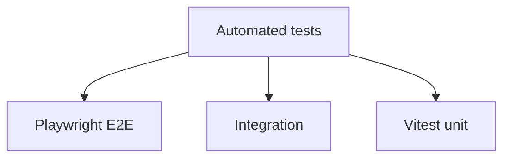

# Testing

**What this page is about:** the real test runners and commands in this repository. There is no Jest configuration; unit work runs on **Vitest** with a small Jest-compat shim for legacy matcher imports.

## Runners

| Layer | Tool | Config |
| ----- | ---- | ------ |
| Unit / component | **Vitest** | `vitest.config.ts` |
| Browser journeys | **Playwright** | `playwright.config.ts` (project standard) |
| Coverage | Vitest **v8** provider | `pnpm test:coverage` |

Vitest uses `jsdom`, `vite-tsconfig-paths`, and `setupFiles`: `vitest.env.ts`, `vitest.jest-shim.ts`, `vitest.global-mocks.ts`, `vitest.setup.ts`. Tests live at `src/**/*.test.{ts,tsx}`; `*.spec.*` files are excluded from Vitest (reserved for Playwright).

## Commands (`package.json`)

```bash
pnpm test              # vitest run (CI default)
pnpm test:watch        # interactive Vitest
pnpm test:coverage     # coverage to ./coverage
pnpm test:ci           # alias vitest run
pnpm e2e:headless      # Playwright without UI
pnpm e2e               # Playwright UI mode
pnpm e2e:docker        # E2E in Docker when stack is up
```

Package manager is **pnpm** (≥ 11). Node **≥ 22**.

## What to test where

- **Pure helpers** (`src/lib/utils`, molecules, parsers): fast Vitest tests with real fixtures; avoid mocking the world — see `.cursor/skills/meaningful-unit-tests/SKILL.md`.
- **React pieces**: Testing Library assertions in Vitest; import from `@testing-library/react` with the Vitest globals enabled.
- **API routes**: prefer tests against handler logic extracted to testable units, or integration tests that hit route handlers with realistic request objects.
- **Critical flows** (sign-in, radio, admin): Playwright specs under `e2e/`.

## Traceability

When a test maps to `requirements-registry.yaml`, prefix the description: `test('[FR-xxx] …', () => { … })`. Hub detail: [/philosophy/traceability](/philosophy/traceability).

## Pyramid (intent, not a hard quota)



Most coverage should be Vitest; Playwright covers a small set of user-critical paths so CI stays under a practical time budget (`testTimeout: 15000` per Vitest test, `maxWorkers: 1` in config for stability on Windows).

The radio catalog health check is the exception. `src/widgets/radio-player/radioStationCatalog.availability.test.ts` probes every station in `RADIO_STATIONS` with the equalizer rules (HTTPS plus `Access-Control-Allow-Origin` for `https://idling.app`). It runs only when `GITHUB_ACTIONS=true`. Local `pnpm test` skips it. `vitest.setup.ts` replaces `fetch`; that test puts the real fetch back from `vitest.real-fetch.ts` before it probes. The site's `/api/radio/stations` probe is separate and does not use this audit.

## Hub vs this file

Curated onboarding: [/guides/testing](/guides/testing). Repo-root `TESTING.md` still contains legacy Jest diagrams — treat it as deprecated; **this file and the hub guide are authoritative** for stack facts.

## When CI fails

| Failure | Likely fix |
| ------- | ---------- |
| Path alias not resolved | Ensure test imports use `@lib`, `@molecules`, etc.; `tsconfigPaths` plugin is required |
| Flaky timer test | Use Vitest fake timers; avoid real `setInterval` without cleanup |
| Playwright timeout | App not on `:3000` or Docker stack not ready |