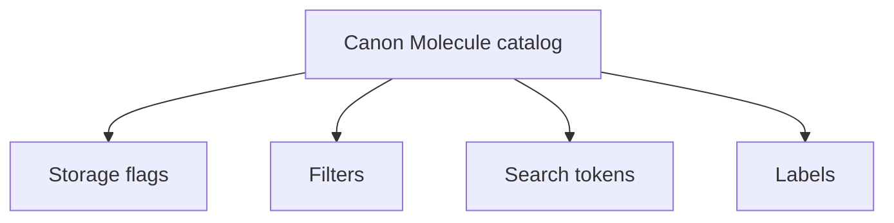

# Canon Molecules

**In plain terms:** when five screens must agree what “Beta” or `@mod:mappy` means, **one module** holds the table — everyone else translates it for UI.

## Rules

1. **One catalog** exports rows (ids, linked fields) and **pure predicates** — no framework imports, no direct SQL.
2. **Projection layers** map ids to copy (i18n, chips, headlines) — never parallel allowlists.
3. **Parity tests** beside the catalog assert storage, filters, and search stay aligned.

## In this repo

Examples under `src/molecules/` include locale and quote catalogs (`idlingLocaleCatalog.ts`). Policy detail for maps lives in **Mappy**: `apps/mappy/docs/policy-catalogs.md` — linked from [mappy product page](/products/showcase/mappy), not duplicated here.

## Canonical reference

Full CLAD treatment: workspace `docs/philosophy/clad.md` § Canon Molecules; Cursor rule `.cursor/rules/canon-molecules.mdc`.