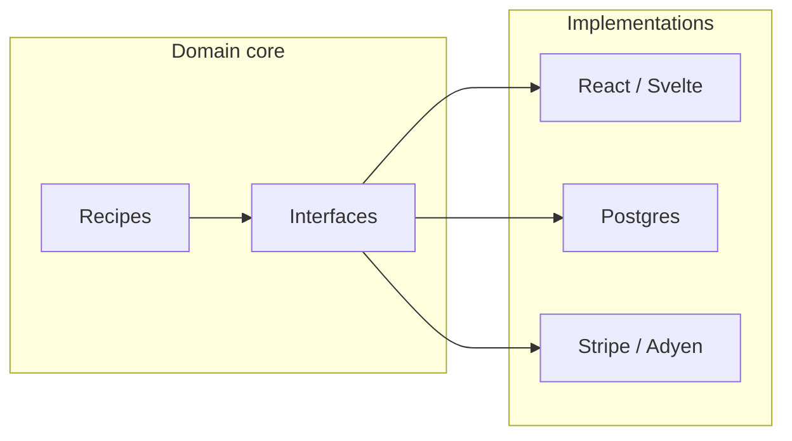

# CLAD — Composable Layered Agnostic Design

> **Source of truth:** `docs/philosophy/clad.md` in the parent `__CODE` workspace repository (living document **v0.7.0**, last updated 2026-05-19). This page is an **adapted hub edition** for docs.idling.app — follow the canonical file for full depth, ADR examples, and revision history.

**What this page is about:** a shared vocabulary for full-stack structure so interns can read it, seniors can defend it in review, and refactors cannot quietly poison boundaries.

## TL;DR

**In plain terms:** CLAD is a **map legend** for code — six sizes of unit, contracts that do not name vendors, and replaceable outer panels.

| Pillar | Meaning |
| ------ | ------- |
| **Composable** | Bigger behaviour is wired from smaller pieces through visible contracts |
| **Layered** | Atom → Molecule → Organism → Recipe → View → App |
| **Agnostic** | Product rules never import Postgres, React, or Stripe by name in the core |
| **Design** | Continuous discipline in naming, reviews, and ADRs — not a one-time blueprint |

CLAD is **advisory**. It is how the team talks — not a merge gate.

## The CLAD stack (kitchen metaphor)

| Tier | In the kitchen | In code |
| ---- | -------------- | ------- |
| **Atom** | A pinch of salt | Constant, enum, tiny type |
| **Molecule** | A vinaigrette | One component, pure function, schema |
| **Organism** | Bread dough | Composition of Molecules with intent |
| **Recipe** | The dish (lasagna) | One use case end-to-end |
| **View** | The plate | Page, route handler, CLI |
| **App** | The restaurant | Deployable; wires implementations |

**Interface** = shopping-list role (port). **Implementation** = the brand you bought this week (adapter). **Forge** = prep station that constructs wired units.

## Ports and adapters (Hexagonal)

Recipes depend on **Interfaces** only. **Implementations** live at the App edge. Swap Postgres for an in-memory plug in tests without rewriting the Recipe.

idling.app examples:

- `src/molecules/` — Canon Molecules and UI helpers
- `src/lib/services/` — Organisms and services behind clear seams
- `src/app/api/**/route.ts` — Views on HTTP

## Canon Molecules (cross-surface truth)

When filters, storage flags, `@` search tokens, and labels must align, **one table-driven catalog** in `src/molecules/*Catalog.ts` owns meaning. Other modules **project** labels — they do not duplicate allowlists. See [Canon Molecules](/philosophy/canon-molecules) and Mappy's `apps/mappy/docs/policy-catalogs.md` for a product-specific catalog.

## Testing and traceability

Prefer **TDD** with Vitest `test(...)` descriptions tagged `[FR-xxx]` from `requirements-registry.yaml`. The tracer CLI audits IDs in CI. See [Traceability](/philosophy/traceability).

## How idling.app uses CLAD

- **Marketing site** — Recipes for auth, admin, radio; Views in App Router; Postgres adapters behind services.
- **Docs hub** — Curated Recipes (guides/products) separate from bootstrap stub neighbours.
- **Docusaurus** — Not a tier in CLAD; it is a View surface for documentation.

## Influences

CLAD draws on **Hexagonal Architecture**, **Clean Architecture**, **Atomic Design** (size names only — not Brad Frost folder rules), and **ports/adapters** discipline. Full attribution table lives in canonical `clad.md` § Influences.

## Getting help

- Deep Socratic review: invoke Cursor skill `clad-advisory`
- Slides: `presentations/clad-overview.qmd` in workspace repo
- Charter: `AGENTS.md` § CLAD and advisory AI