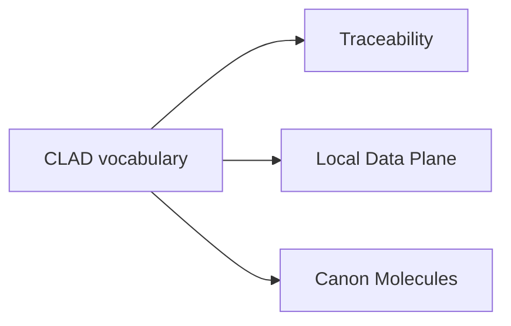

# Philosophy

**What this page is about:** how the Underwood-Inc workspace talks about structure — adapted for the docs hub with links to canonical sources in the parent `__CODE` repository.

## Pages in this section

| Page | Purpose |
| ---- | ------- |
| [CLAD](/philosophy/clad) | Composable Layered Agnostic Design (hub edition, cites v0.7.0 source) |
| [Canon Molecules](/philosophy/canon-molecules) | One catalog table owns cross-surface meaning |
| [Traceability](/philosophy/traceability) | FR-IDs, requirements-tracer, CI audit |
| [Local Data Plane](/philosophy/local-data-plane) | Desktop-scale local storage framework |
| [AI instructions map](/philosophy/ai-instructions) | VS Code, Cursor, Copilot policy index |

Canonical living documents live under `c:\Users\mamop\Documents\__CODE\docs\` — this hub **adapts** them for Docusaurus; when depth matters, follow the source links.