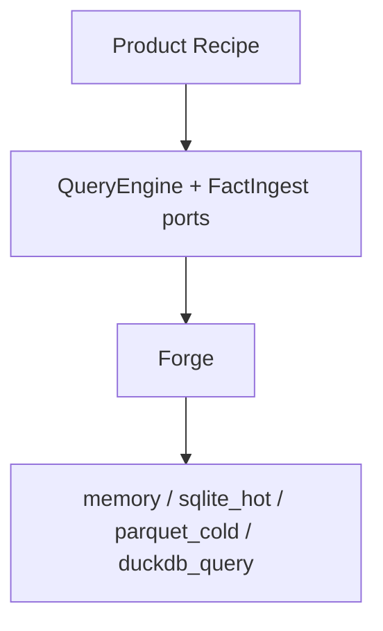

# Local Data Plane (LDP)

**In plain terms:** desktop apps that must hold **millions of local facts** and still scroll at game speed use LDP — a **port/adapter framework** tested in the template app first, then consumed by products like Overlane.

## TL;DR

- **Framework code:** `apps/hello-desktop/packages/local-data-plane/` in the `__CODE` workspace
- **Requirements:** `docs/requirements/local-data-plane.yaml` (`FR-LDP-*`, `NFR-LDP-*`)
- **Overlane:** thin adapters under `scs-telemetry-overlay/internal/adapters/overlane/` — do not fork LDP inside Overlane

Recipes talk to **`QueryEnginePort`**, **`FactIngestPort`**, and **`Forge`** — not SQLite/DuckDB types directly.

## Adapter profiles

Canon table in `AdapterProfileCatalog` selects hot/cold/query bundles. Golden parity tests live in `go/reference/overlane_fixture/`.

## Hub links

- [Overlane](/products/showcase/overlane) — telemetry + Memory Lane
- [Hello Desktop](/products/ensemble/hello-desktop) — template host for LDP

## Canonical README

Full architecture: `docs/architecture/local-data-plane/README.md` (v1.0.0, approved-for-implementation).