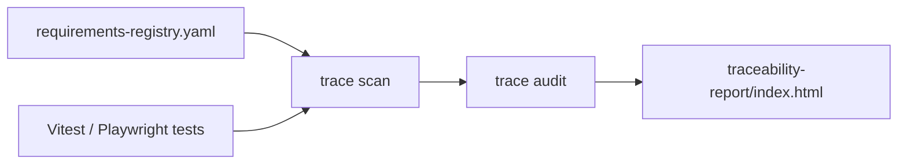

# Traceability

**What this page is about:** tying automated tests to human requirements so coverage means something in audit — adapted from workspace `docs/traceability/index.md`.

## TL;DR

- Every meaningful test description includes a trace ID like `[FR-001]` that exists in `requirements-registry.yaml`.
- Optional JSDoc tags (`@description`, `@owner`, `@kind`, …) sit above `test(...)` — see `docs/traceability/jsdoc-tags.md`.
- CLI: `tools/requirements-tracer/` — `pnpm trace:scan`, `pnpm trace:audit`, `pnpm trace:report`.
- CI: `.github/workflows/traceability.yml` fails on missing or unknown IDs.

## idling.app__UI

This repo participates when registry entries and tagged tests are present. Hub testing guidance: [Testing](/guides/testing).

## Canonical docs

| Resource | Path in `__CODE` workspace |
| -------- | -------------------------- |
| Overview | `docs/traceability/index.md` |
| Onboarding | `docs/traceability/onboarding.md` |
| CI wiring | `docs/traceability/ci-integration.md` |
| JSDoc tags | `docs/traceability/jsdoc-tags.md` |

CLAD positions traceability as **supporting discipline**, not a second law beside product judgement.