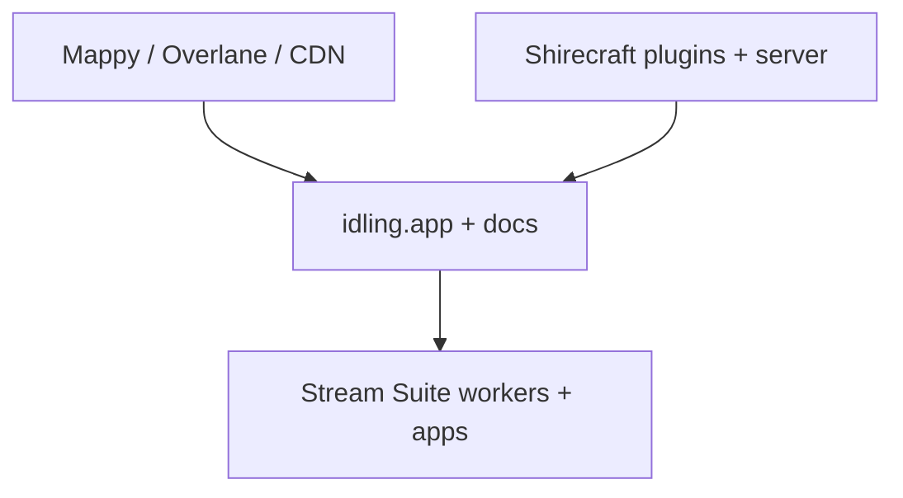

# Product ensemble

**What this page is about:** one hub page per product the team ships, markets, or operates — the [living inventory](/products/inventory) is the scope boundary, not the homepage carousel alone.

## Families

| Family | Index |
| ------ | ----- |
| Marketing + docs site | [Idling.app](/products/ensemble/idling-app) |
| Stream Suite (OBS, auth, mods, workers) | [Stream Suite](/products/stream-suite) |
| Maps and desktop | [Mappy](/products/showcase/mappy) · [Overlane](/products/showcase/overlane) · [Mappy maps CDN](/products/ensemble/mappy-maps-cdn) |
| Shirecraft Minecraft | [Shirecraft hub](/products/shirecraft-hub) |
| Living catalog | [Product inventory](/products/inventory) |

## Showcase catalog (marketing carousel)

Definitions for carousel cards live in `src/app/components/project-showcase/projectShowcaseProjects.ts`. Each `id` with a carousel slot has a matching page under [Showcase](/products/showcase/overlane). Products without a carousel slot use [Ensemble](/products/ensemble/streamkit) (Workers, Paper plugins, ops bots, CDN).

## Extended ensemble (sampler)

| Kind | Examples |
| ---- | -------- |
| Cloudflare Workers | [Suite API](/products/ensemble/suite-api), [Mods API](/products/ensemble/mods-api), [Customer API](/products/ensemble/customer-api), [Feature Flag Service](/products/ensemble/feature-flag-service) |
| Pages / Vite apps | [Flags Admin](/products/ensemble/flags-admin), [Chat Hub](/products/ensemble/chat-hub), [design.idling.app](/products/ensemble/design-idling-app) |
| Paper plugins | [ShireSell](/products/ensemble/shire-sell), [Barrel PC](/products/ensemble/barrel-pc), [Infinite Fishing Craft](/products/ensemble/infinite-fishing-craft) |
| Ops | [Discord Defect Bot](/products/ensemble/discord-defect-bot), [Control Panel](/products/ensemble/control-panel) |

## Rule for new products

Add or update a row in [inventory](/products/inventory), add `showcase/` or `ensemble/` hub markdown with a **Sources (audited)** footer, and cross-link from [Stream Suite](/products/stream-suite) when the deployable is a worker.