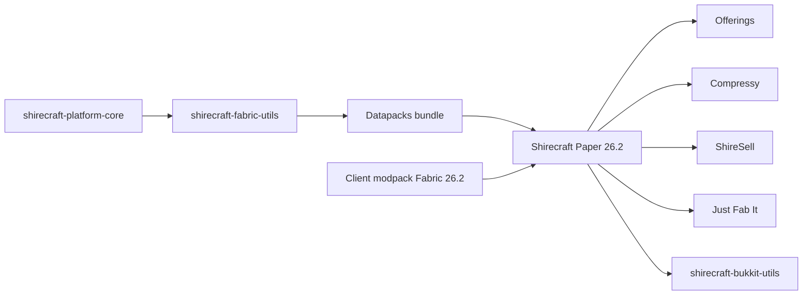

# Shirecraft family

**In plain terms:** a whitelist survival server (`mc.idling.app`) surrounded by plugins and datapacks the community runs every season.

## Server and modpack

| Item | Hub |
| ---- | --- |
| Shirecraft server | [Showcase](/products/showcase/shirecraft) |
| Official Shirecraft client modpack | [Ensemble](/products/ensemble/shirecraft-modpack) |
| Trials of the Wild modpack | [Showcase](/products/showcase/trials-of-the-wild) |

## Plugins (Paper / Spigot)

| Product | Hub |
| ------- | --- |
| Compressy | [Showcase](/products/showcase/compressy) |
| Offerings | [Showcase](/products/showcase/offerings) |
| Tally (datapack) | [Showcase](/products/showcase/tally) |
| ShireSell | [Ensemble](/products/ensemble/shire-sell) |
| ShireMenus | [Ensemble](/products/ensemble/shire-menus) |
| Barrel PC | [Ensemble](/products/ensemble/barrel-pc) |
| Anchors | [Ensemble](/products/ensemble/anchors) |
| Infinite Fishing Craft | [Ensemble](/products/ensemble/infinite-fishing-craft) |
| Just Fab It | [Ensemble](/products/ensemble/just-fab-it) |

## Datapacks and content

| Product | Hub |
| ------- | --- |
| Rituals | [Showcase](/products/showcase/rituals) |
| Alloys | [Showcase](/products/showcase/alloys) |
| Shirecraft datapack bundle (`infinitefishing-rods`) | [Ensemble](/products/ensemble/shirecraft-datapacks) |

## Authoring tools

| Tool | Hub |
| ---- | --- |
| MC Display Editor | [Ensemble](/products/ensemble/mc-display-editor) |

## Shared libraries

| Library | Hub |
| ------- | --- |
| shirecraft-bukkit-utils | [Ensemble](/products/ensemble/shirecraft-bukkit-utils) |
| shirecraft-platform-core | [Ensemble](/products/ensemble/shirecraft-platform-core) |
| shirecraft-fabric-utils | [Ensemble](/products/ensemble/shirecraft-fabric-utils) |

## Architecture sketch

## Operator notes

- Minecraft target for current season: **26.2** (see each plugin README).
- LuckPerms integration is standard for rank-gated plugins (Compressy, Offerings).
- `shire-daily` and other incomplete stubs are **not shipped** — omitted until a release exists.

## Related

- [Product inventory](/products/inventory) for `last_verified` dates