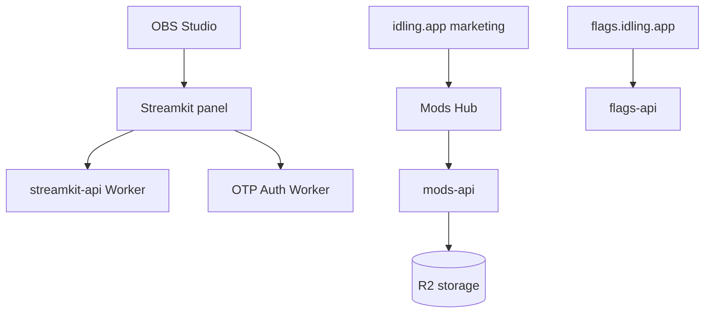

# Strixun Stream Suite

**In plain terms:** the cloud half of streaming production — passwordless auth, permissions, mod downloads, URL shortener, and the Streamkit control panel that talks to OBS.

**Repo:** `strixun-stream-suite` (sibling under `__CODE`). **Audit doc:** `product-docs/COMPREHENSIVE_PRODUCT_OVERVIEW.md` (v1.0.0).

## Consumer-facing surfaces

| Product | Live | Hub page |
| ------- | ---- | -------- |
| Streamkit (OBS panel) | https://streamkit.idling.app | [OBS Animation Suite](/products/showcase/obs-animation-suite) |
| Auth (OTP) | https://auth.idling.app | [Auth Service](/products/showcase/auth-service) |
| Access Hub | https://access.idling.app | [Access Hub](/products/showcase/access-hub) |
| Access API | https://access-api.idling.app | [Access API](/products/ensemble/access-api) |
| Mods Hub | https://mods.idling.app | [Mods Hub](/products/showcase/mods-hub) |
| Mods API | https://mods-api.idling.app | [Mods API](/products/ensemble/mods-api) |
| URL shortener | https://s.idling.app | [URL Shortener](/products/showcase/url-shortener) |
| Chat Hub | https://chat.idling.app | [Chat Hub](/products/ensemble/chat-hub) |
| Feature flags admin | https://flags.idling.app | [Flags Admin](/products/ensemble/flags-admin) |
| Component Storybook | https://design.idling.app | [design.idling.app](/products/ensemble/design-idling-app) |

## Shared packages (NPM)

| Package | Hub page |
| ------- | -------- |
| shared-components | [Showcase](/products/showcase/shared-components) |
| api-framework | [Showcase](/products/showcase/api-framework) |
| search-query-parser | [Showcase](/products/showcase/search-query-parser) |
| streamkit-api worker | [Showcase](/products/showcase/streamkit-api) |

## Suite workers

Each production worker is cross-linked below (full catalog: [Product inventory](/products/inventory)):

| Worker | Production host | Hub |
| ------ | ----------------- | --- |
| `strixun-customer-api` | customer-api.idling.app | [Customer API](/products/ensemble/customer-api) |
| `strixun-mods-api` | mods-api.idling.app | [Mods API](/products/ensemble/mods-api) |
| `strixun-game-api` | game.idling.app | [Game API](/products/ensemble/game-api) |
| `strixun-music-api` | music-api.idling.app | [Music API](/products/ensemble/music-api) |
| `feature-flag-service` | flags-api.idling.app | [Feature Flag Service](/products/ensemble/feature-flag-service) |
| `strixun-suite-api` | api.idling.app | [Suite API](/products/ensemble/suite-api) |
| `strixun-chat-signaling` | chat-api.idling.app | [Chat Signaling API](/products/ensemble/chat-signaling) |
| `strixun-access-service` | access-api.idling.app | [Access API](/products/ensemble/access-api) |
| `strixun-streamkit-api` | streamkit-api.idling.app | [Streamkit API](/products/showcase/streamkit-api) |
| `strixun-otp-auth-service` | auth.idling.app | [Auth Service](/products/showcase/auth-service) |
| `strixun-url-shortener` | s.idling.app | [URL Shortener](/products/showcase/url-shortener) |

Optional narrative audit: `strixun-stream-suite/product-docs/COMPREHENSIVE_PRODUCT_OVERVIEW.md`.

| App | Hub |
| --- | --- |
| control-panel (local dev) | [Control Panel](/products/ensemble/control-panel) |
| dice-board-game (embed library) | [Dice Board Game](/products/ensemble/dice-board-game) |

**R2 operator repo (sibling, not in monorepo):** [Cloudflare Edge](/products/ensemble/cloudflare-edge) — `mappymaps` bucket; pairs with [Mappy Maps CDN](/products/ensemble/mappy-maps-cdn).

## SSO and CORS

`*.idling.app` properties share OTP auth and Access RBAC. Docs site (`docs.idling.app`) participates in the same cookie/CORS policy family — operators configure origins in suite repos, not in this UI repo.

## When things go wrong

| Symptom | Check |
| ------- | ----- |
| 401 across suite | Auth worker status, JWT clock skew |
| Mod upload failures | mods-api + R2 credentials |
| Streamkit sync stale | streamkit-api KV bindings |

## Related

- [Streamkit](/products/ensemble/streamkit) worker detail
- [Idling.app](/products/ensemble/idling-app) · marketing routes under `/strixun-stream-suite/*`